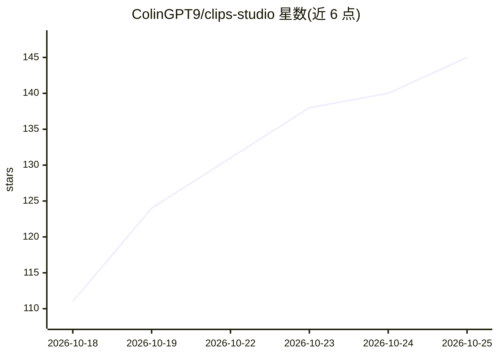

# ColinGPT9/clips-studio

⭐ 145 · Python · AGPL-3.0 · 推送 2026-10-24 · [GitHub](https://github.com/ColinGPT9/clips-studio) · [官网](https://colingpt9.github.io/clips-studio/) · 个人维护 · 中文 README

**本地 AI 视频切片工具：把直播/长视频自动剪成竖屏短视频**

面向小体量 YouTuber 与主播的免费开源桌面应用：粘贴 YouTube/Twitch/Kick 链接或本地文件，自动找精彩片段、裁成 9:16 并保持说话人居中（YOLOv8 姿态 + TalkNet 说话人检测）、烧录词级同步字幕、生成标题/描述/标签。默认全流程本地运行：faster-whisper 转录（CUDA/CPU）、本地 LLM 打分与重排、Ollama 跑 LLM；PC 跑不动时可走 OpenRouter 等云服务（自付账单），OpenAI/Claude/Gemini/DeepSeek/Qwen 等也可用自有 API key。含非破坏性编辑器、AI 编辑对话、多语言字幕与本地 TTS 配音、足球/篮球模式。AGPL-3.0，Windows 提供 Microsoft Store 安装包与 Docker。

## 筛选速览

| 维度 | 判定 | 备注 |
|---|---|---|
| AI 角色 | `ai-native` | 本体是模型或模型工具 |
| 许可风险 | `viral` | AGPL-3.0 |
| 部署形态 | `desktop` | 安装包/桌面程序 |
| 模型依赖 | local-ok | 支持本地模型 |
| 硬件要求 | `gpu-8g` | |
| 安装摩擦 | `low` | 无编译、无系统依赖或容器化 |
| 成熟度 | — | 结构信号不足 |

## 能力要点

- 五信号融合打分（转录/音频/视觉/反应/观众数据）+ 小模型决赛圈重排选片段
- 说话人感知人脸跟踪与播客模式，画面跟随实际说话者
- 本地优先：faster-whisper 转录 + 本地 LLM（Ollama），视频不出本机
- 支持足球/篮球赛事模式：比分框确认进球、9:16 构图跟随球
- Creator Profiles 按创作者积累知识库，可查看/修正/清除

## 适用场景

- 把直播回放或长视频批量剪成可发布的 Shorts/Reels/TikTok 竖屏切片
- 本地免费剪辑，不按条付费也不上传原始视频
- 足球/篮球比赛自动切出进球、扣篮等关键时刻并生成集锦
- 老电脑跑不动本地 AI 时切换到自己的 OpenRouter 账号云端处理

## 场景标签

`图像视频处理` · 领域:感知与多模态

## 证据(README 行号)

> L37: **Turn long streams and videos into ready-to-post Shorts, Reels, and TikToks,
> L169: through Ollama.

## 星数曲线

2026-10-18 111 → 2026-10-25 145（+34）

---
*卡片 v1 · prompt 1.4 · 生成 2026-10-22 · 置信度 mid · 依据 README sha `347aef5cc58e` · [字段定义](../../DATASET.md)*
