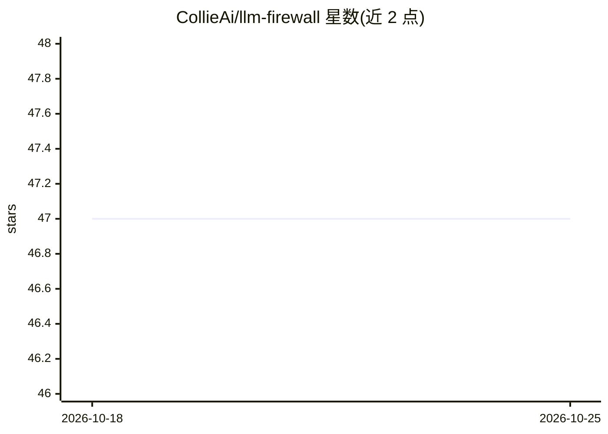

# CollieAi/llm-firewall

⭐ 47 · MIT · 推送 2026-10-20 · [GitHub](https://github.com/CollieAi/llm-firewall) · [官网](https://collieai.io) · 组织维护

**面向 LLM 应用的安全代理：拦截注入、脱敏 PII、审计调用**

CollieAi 提供的 LLM Firewall 是部署在应用与 LLM 提供商之间的透明代理：仅改 base_url 即接入 OpenAI SDK 兼容客户端，路由到 OpenAI、Anthropic、Gemini、DeepSeek、Azure OpenAI、AWS Bedrock 及 vLLM/Ollama/LocalAI 等自托管端点。检测层含正则、校验和（Luhn/MOD-97）、Aho-Corasick 字典与 10-50 ms ML 分类器，覆盖提示注入、PII 与密钥泄露、恶意 URL、隐藏载荷等 6 类可配置规则，支持 monitor/enforce 模式、输入输出独立策略与全量审计日志。提供免费层（每月 2 万次调用）与 Docker Compose 自托管指南；企业版增加本地部署、SSO 与 SIEM 集成。

## 筛选速览

| 维度 | 判定 | 备注 |
|---|---|---|
| AI 角色 | `ai-ecosystem` | LLM/agent 周边工具 |
| 许可风险 | `permissive` | MIT |
| 部署形态 | `self-host` | docker 或自建部署 |
| 模型依赖 | local-ok | 支持本地模型 |
| 硬件要求 | — | 无带数字的原话,不猜 |
| 安装摩擦 | `low` | 无编译、无系统依赖或容器化 |
| 成熟度 | — | 结构信号不足 |

## 能力要点

- 改 base_url 即接入的 OpenAI 兼容安全代理，零 SDK 改动
- PII 检测与脱敏：正则、Luhn/MOD-97 校验、Aho-Corasick 字典
- 10-50 ms ML 分类器检测提示注入/越狱，可选 LLM 二次分析
- monitor/enforce 双模式规则引擎与全量审计日志、Dashboard

## 适用场景

- 在生产应用与 LLM 提供商之间统一拦截提示注入与越狱攻击
- 在数据流向第三方模型前自动脱敏信用卡、IBAN、密钥等敏感信息
- 按项目集中管理护栏策略并留存每次调用的审计记录
- 为调用 OpenAI 兼容端点的 agent 框架（LangChain/CrewAI 等）加防护

## 场景标签

`网络安全` `模型网关` · 领域:Agent 开发

## 证据(README 行号)

> L7: Drop-in, provider-agnostic AI guardrails proxy that masks PII, blocks prompt injection & jailbreaks, and logs every 
> L26: - **Drop-in OpenAI-compatible proxy** — change `base_url`, keep your SDK. Python, Node.js, Go, curl — anything that
> L130: CollieAi routes to any OpenAI-compatible LLM provider. Configure your provider token in the dashboard — CollieAi h

## 星数曲线

2026-10-18 47 → 2026-10-25 47（+0）

---
*卡片 v1 · prompt 1.4 · 生成 2026-10-25 · 置信度 high · 依据 README sha `f2c8aeb4281d` · [字段定义](../../DATASET.md)*
