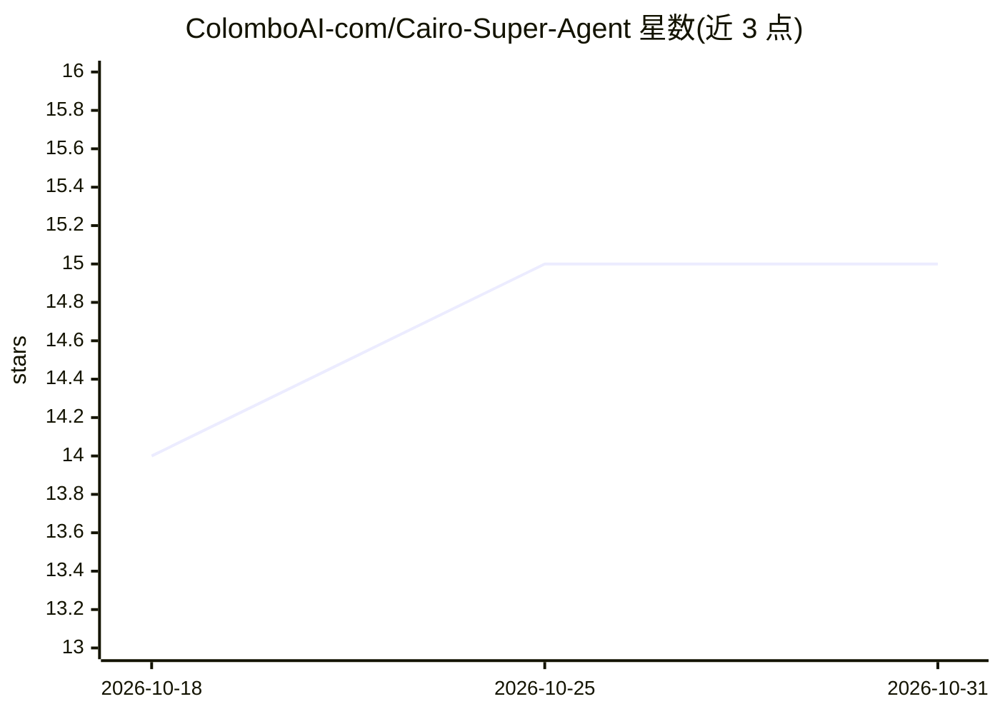

# ColomboAI-com/Cairo-Super-Agent

⭐ 15 · CSS · 推送 2026-07-27 · [GitHub](https://github.com/ColomboAI-com/Cairo-Super-Agent) · [官网](https://Cairo.sh) · 组织维护

**面向终端用户的 AI 超级代理：以目标驱动自主执行任务**

Cairo Super Agent 是一个软件优先的 AI 操作系统：用户输入目标后，系统进行意图分解、生成任务图、分配 agent 群、按层级路由模型（本地模型/Ollama/Hugging Face/OpenRouter/前沿 API）、通过受治理工具执行并自愈与学习。提供浏览器 WebUI 与 Windows/Linux/macOS 桌面安装包，预置免费模型 Cairo MC-1，本地与前沿模型为可选配置。界面含 Workspace、Operator Dashboard、Cairo Code 与 Cairo Software Engineer 四个产品面。需联网与至少 4GB 内存。

## 筛选速览

| 维度 | 判定 | 备注 |
|---|---|---|
| AI 角色 | `ai-native` | 本体是模型或模型工具 |
| 许可风险 | `none` | — |
| 部署形态 | `None` |  |
| 模型依赖 | local-ok | 支持本地模型 |
| 硬件要求 | — | 无带数字的原话,不猜 |
| 安装摩擦 | `low` | 无编译、无系统依赖或容器化 |
| 成熟度 | — | 结构信号不足 |

## 能力要点

- 目标驱动的自主执行：意图分解、任务图、agent 群分配与治理执行
- 模型分层路由：Cairo MC-1 默认免费，可配 Ollama/Hugging Face/OpenRouter/前沿 API
- 四大产品面：Workspace、Operator Dashboard、Cairo Code、Cairo Software Engineer
- 自愈、检查点与长时程任务延续（CSIP/LHTK/Operational DNA 等机制）

## 适用场景

- 用自然语言目标驱动 AI 代为完成工作与编码任务
- 在大代码库上执行重构、构建、测试、修复等工程流程
- 私有/低成本场景下配合 Ollama 本地模型运行
- 运营'自主公司'与插件/MCP 扩展生态

## 场景标签

`多智能体` `编码 Agent` `AI 助手` · 领域:Agent 开发

## 证据(README 行号)

> L118: Cairo Super Agent is a software-first AI operating system that turns goals into governed execution across models, 
> L124: |Goal layer|Converts natural goals into intent, task graphs, execution policies, and measurable outcomes.|
> L193: Choose the installer for your operating system, install Cairo Desktop, sign in, and connect your preferred model p

## 星数曲线

2026-10-18 14 → 2026-10-31 15（+1）

---
*卡片 v1 · prompt 1.4 · 生成 2026-10-31 · 置信度 high · 依据 README sha `9a1c17934084` · [字段定义](../../DATASET.md)*
