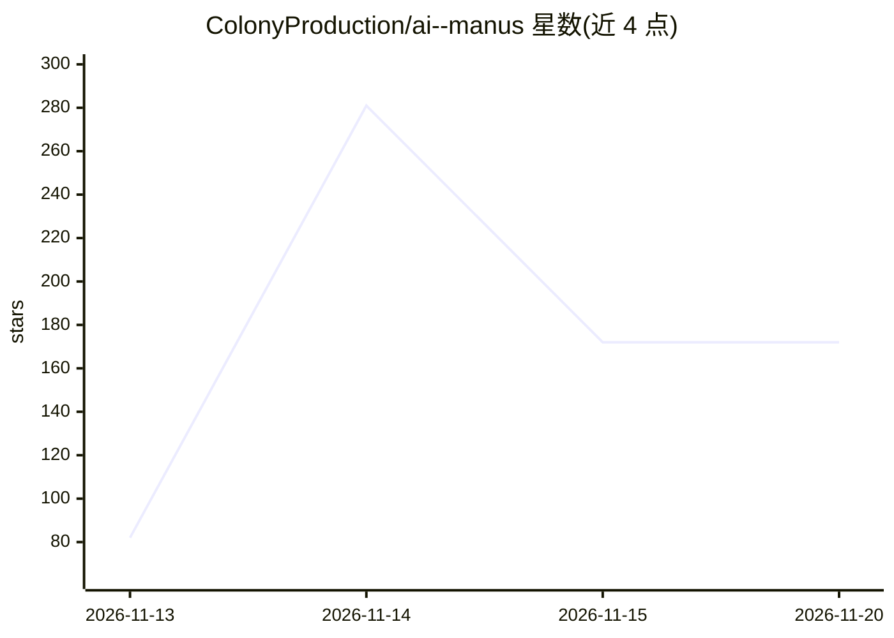

# ColonyProduction/ai--manus

⭐ 172 · Apache-2.0 · 推送 2026-11-15 · [GitHub](https://github.com/ColonyProduction/ai--manus) · 组织维护

**面向个人日常任务的自主 AI Agent：执行代码并控制浏览器**

Manus 定位为自主 AI Agent，可在最少监督下编写并执行脚本、打开网页、与页面元素交互、完成多步任务，覆盖代码执行与浏览器控制两类操作，两者可在同一工作流中衔接。目标用户为非开发者的学生、远程工作者与轻量办公人群，用于研究整理、信息收集、重复性小任务等场景。README 提供兼容性表（最低双核 CPU、4 GB 内存）与上手步骤说明，但未给出具体安装命令、模型接入方式或代码仓库结构等可验证的技术细节，且内容呈现明显的搜索关键词堆砌风格。

## 筛选速览

| 维度 | 判定 | 备注 |
|---|---|---|
| AI 角色 | `ai-native` | 本体是模型或模型工具 |
| 许可风险 | `permissive` | Apache-2.0 |
| 部署形态 | `None` |  |
| 模型依赖 | — | README 未给出锁定关系 |
| 硬件要求 | — | 无带数字的原话,不猜 |
| 安装摩擦 | `low` | 无编译、无系统依赖或容器化 |
| 成熟度 | — | 结构信号不足 |

## 能力要点

- 自主执行代码：无需人工逐步编写与调试
- 浏览器控制：导航网页、填写表单、收集信息
- 脚本与浏览器操作可在同一工作流中衔接，跨会话复用任务模式
- 面向家庭、学习与轻量办公的小规模任务设计

## 适用场景

- 让学生组织研究笔记并运行快速计算
- 让远程工作者从多个网页收集数据
- 把重复性的小任务委托给后台 Agent 处理
- 快速运行小脚本实验并对比结果

## 场景标签

`AI 助手` `浏览器自动化` `编码 Agent` · 领域:效率与自动化

## 证据(README 行号)

> L10: - **Autonomous Code Execution:** Manus AI agent runs code on its own to complete tasks, so you can focus on decisio
> L18: Manus is an autonomous AI agent designed to run code and control a browser on your behalf. Instead of acting like a

## 星数曲线

2026-11-13 82 → 2026-11-20 172（+90）

---
*卡片 v1 · prompt 1.4 · 生成 2026-11-17 · 置信度 mid · 依据 README sha `0f78ee3a5dd2` · [字段定义](../../DATASET.md)*
