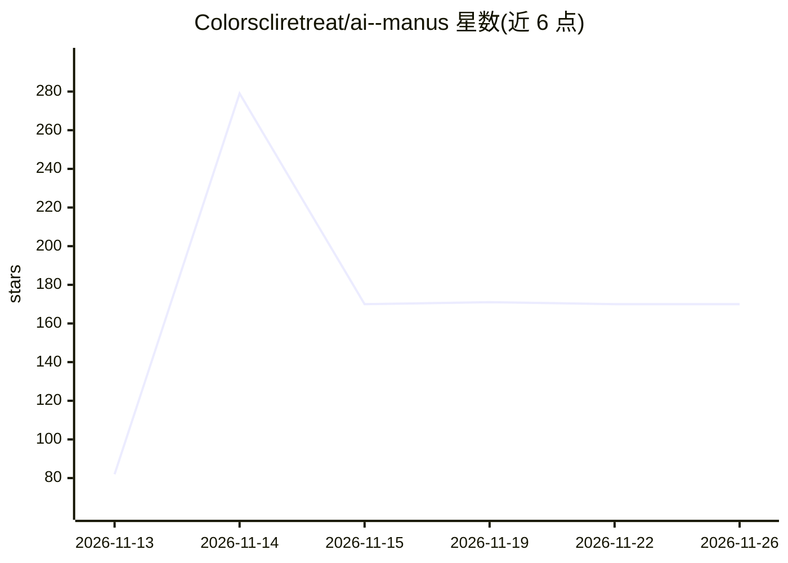

# Colorscliretreat/ai--manus

⭐ 170 · Apache-2.0 · 推送 2026-11-15 · [GitHub](https://github.com/Colorscliretreat/ai--manus) · 个人维护

**自主 AI Agent：代用户执行代码与控制浏览器完成多步任务**

面向家庭、学习与轻量办公场景的自主 AI 代理：接受自然语言指令后自行编写并执行脚本、打开网页、操作页面元素并完成多步骤任务，代码执行与浏览器控制可在同一流程内衔接。定位为个人助理式的小型任务助手，非企业平台。README 描述了启动步骤（准备、配置、测试、逐步扩展），但未给出具体的安装命令、技术栈或代码入口，仅以 'Download Manus' 与促销码 'PROMO2026' 指向下载。

## 筛选速览

| 维度 | 判定 | 备注 |
|---|---|---|
| AI 角色 | `ai-native` | 本体是模型或模型工具 |
| 许可风险 | `permissive` | Apache-2.0 |
| 部署形态 | `None` |  |
| 模型依赖 | — | README 未给出锁定关系 |
| 硬件要求 | — | 无带数字的原话,不猜 |
| 安装摩擦 | `low` | 无编译、无系统依赖或容器化 |
| 成熟度 | — | 结构信号不足 |

## 能力要点

- 自主代码执行：代理自行编写并运行脚本完成任务
- 浏览器控制：导航网页、填写表单、采集信息
- 跨会话记忆：对重复工作流应用相同处理逻辑
- 代码与浏览器动作在同一任务流中衔接

## 适用场景

- 让代理代替我跑小脚本和快速计算
- 自动检查网页更新、填写重复表单
- 整理研究笔记与多页资料汇总

## 场景标签

`AI 助手` `编码 Agent` `浏览器自动化` · 领域:效率与自动化

## 证据(README 行号)

> L10: - **Autonomous Code Execution:** Manus AI agent runs code on its own to complete tasks, so you can focus on decisio
> L18: Manus is an autonomous AI agent designed to run code and control a browser on your behalf. Instead of acting like a

## 星数曲线

2026-11-13 82 → 2026-11-26 170（+88）

---
*卡片 v1 · prompt 1.4 · 生成 2026-11-17 · 置信度 mid · 依据 README sha `0f78ee3a5dd2` · [字段定义](../../DATASET.md)*
