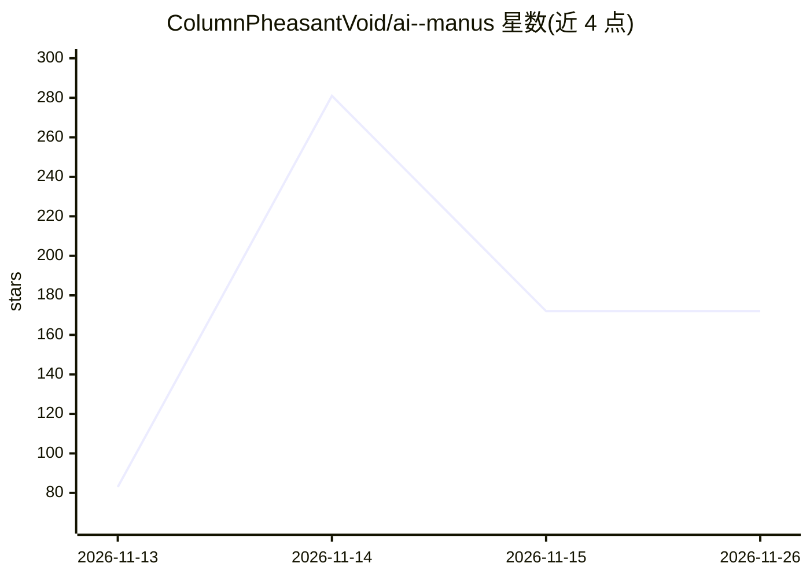

# ColumnPheasantVoid/ai--manus

⭐ 172 · Apache-2.0 · 推送 2026-11-15 · [GitHub](https://github.com/ColumnPheasantVoid/ai--manus) · 个人维护

**面向日常小任务的自主 AI Agent，可执行代码与控制浏览器**

README 自述为一个自主运行的 AI Agent：可自行编写并执行脚本、控制浏览器完成网页导航、表单填写与信息收集，支持多步任务、跨会话记忆工作模式。定位为个人助手而非企业平台，场景覆盖学习研究、家庭事务、轻量办公与开发测试。给出硬件兼容表（建议 8GB 内存、多核 CPU）与六步上手流程，但未提供任何安装命令、下载链接有效路径或代码结构说明，README 以功能介绍与搜索关键词为主。

## 筛选速览

| 维度 | 判定 | 备注 |
|---|---|---|
| AI 角色 | `ai-native` | 本体是模型或模型工具 |
| 许可风险 | `permissive` | Apache-2.0 |
| 部署形态 | `None` |  |
| 模型依赖 | — | README 未给出锁定关系 |
| 硬件要求 | — | 无带数字的原话,不猜 |
| 安装摩擦 | `low` | 无编译、无系统依赖或容器化 |
| 成熟度 | — | 结构信号不足 |

## 能力要点

- 自主执行代码与控制浏览器完成多步任务
- 跨会话记忆并可重复应用工作流程
- 面向家庭、学习与轻量办公的小规模场景

## 适用场景

- 让 agent 代为收集网页资料并整理摘要
- 自动执行重复性脚本与文件整理任务
- 远程技术支持中自动检查系统页面

## 场景标签

`AI 助手` `浏览器自动化` `编码 Agent` · 领域:效率与自动化

## 证据(README 行号)

> L10: - **Autonomous Code Execution:** Manus AI agent runs code on its own to complete tasks, so you can focus on decisio
> L18: Manus is an autonomous AI agent designed to run code and control a browser on your behalf. Instead of acting like a

## 星数曲线

2026-11-13 83 → 2026-11-26 172（+89）

---
*卡片 v1 · prompt 1.4 · 生成 2026-11-17 · 置信度 low · 依据 README sha `0f78ee3a5dd2` · [字段定义](../../DATASET.md)*
