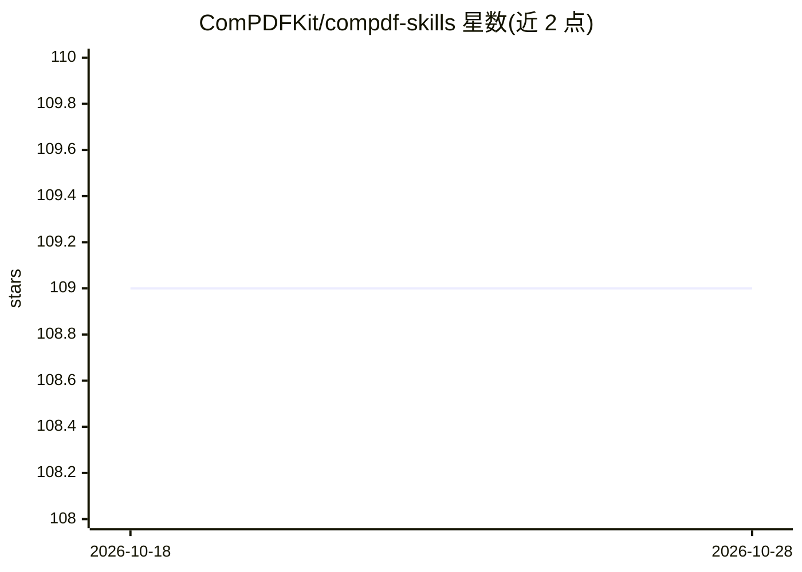

# ComPDFKit/compdf-skills

⭐ 109 · 推送 2026-08-12 · [GitHub](https://github.com/ComPDFKit/compdf-skills) · [官网](https://www.compdf.com/?utm_source=github&utm_medium=skills_about&utm_campaign=compdf_github_skills_about_repo&ref_platform_id=github_compdfkit) · 组织维护 · 中文 README

**面向 39+ 编码代理的 PDF/图像处理技能包，含转换编辑解析**

ComPDFKit 公司发布的 AI 代理技能（Skills）集合：以 SKILL.md 目录形式分发给 Claude Code、Cursor、Windsurf、Cline 等代理平台，覆盖 PDF/图像解析与数据提取（OCR、表格字段抽取）、20 余种格式转换（PDF↔Word/Excel/HTML/Markdown/JSON 等）、PDF 页面编辑与加解密水印。流程为先用 ComPDF 做文档预处理、再把结构化结果传给大模型，以减少 token 消耗。安装后需注册获取 License 与 API Key，提供免费月度处理额度。

## 筛选速览

| 维度 | 判定 | 备注 |
|---|---|---|
| AI 角色 | `ai-ecosystem` | LLM/agent 周边工具 |
| 许可风险 | `none` | — |
| 部署形态 | `library` | 以包/库形式分发 |
| 模型依赖 | — | README 未给出锁定关系 |
| 硬件要求 | — | 无带数字的原话,不猜 |
| 安装摩擦 | `low` | 无编译、无系统依赖或容器化 |
| 成熟度 | — | 结构信号不足 |

## 能力要点

- PDF/图像解析与数据提取：文本、表格、字段、OCR 生成可搜索 PDF/OFD
- 20 余种格式互转（Word/Excel/PPT/HTML/Markdown/JSON/CSV/RTF/图片等）
- PDF 页面级操作：合并、拆分、旋转、插页、水印、AES 加解密
- 提供 Claude Code/Windsurf/Cline/Cursor 各平台的安装启用步骤

## 适用场景

- 在代理工作流中把 PDF/扫描件先转为 Markdown/JSON 再交给模型分析
- 从发票、对账单、扫描表格中提取结构化数据供财务审核或系统录入
- 在代理对话中直接合并、拆分、加水印或转换 PDF 文档

## 场景标签

`文档解析` `OCR` · 领域:知识与检索

## 证据(README 行号)

> L7: **ComPDF Skills** provide **PDF and image parsing, data extraction, document format conversion, and PDF processing c
> L35: ComPDF Skills provide document conversion, PDF operations, and intelligent parsing and data extraction for agents, 
> L164: Upload a PDF, image, or other source file. Enter a task instruction such as extracting tables, converting formats,

## 星数曲线

2026-10-18 109 → 2026-10-28 109（+0）

---
*卡片 v1 · prompt 1.4 · 生成 2026-10-23 · 置信度 high · 依据 README sha `7cf790fa2c31` · [字段定义](../../DATASET.md)*
