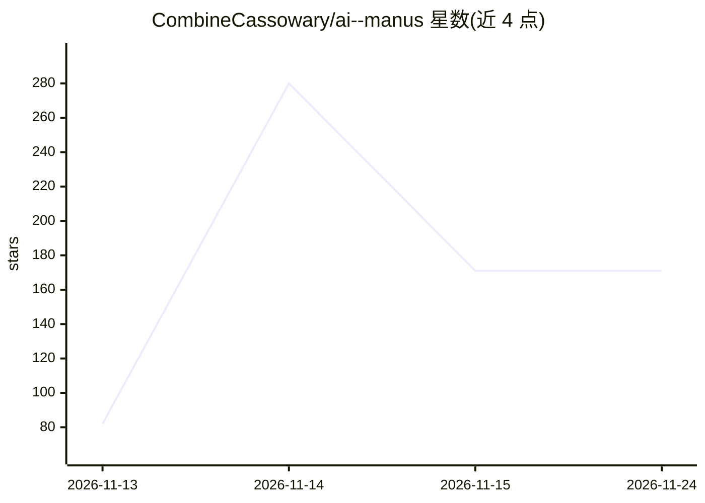

# CombineCassowary/ai--manus

⭐ 171 · Apache-2.0 · 推送 2026-11-15 · [GitHub](https://github.com/CombineCassowary/ai--manus) · 个人维护

**面向个人用户的自主 AI 代理：代用户执行代码与浏览器操作**

面向家庭、学习与轻量办公场景的自主 AI Agent：用户以自然语言描述需求，代理自行编写并执行脚本、打开网页、填写表单、完成多步任务，可在后台常驻并跨会话沿用已建立的工作模式。README 描述其运行形态为代码执行与浏览器控制结合，无需编程基础。兼容性表列出最低双核 CPU、4 GB 内存、64 位系统等要求。README 未给出具体的安装命令、模型接入方式或源码构建步骤，仅提供使用流程说明。

## 筛选速览

| 维度 | 判定 | 备注 |
|---|---|---|
| AI 角色 | `ai-native` | 本体是模型或模型工具 |
| 许可风险 | `permissive` | Apache-2.0 |
| 部署形态 | `None` |  |
| 模型依赖 | — | README 未给出锁定关系 |
| 硬件要求 | — | 无带数字的原话,不猜 |
| 安装摩擦 | `low` | 无编译、无系统依赖或容器化 |
| 成熟度 | — | 结构信号不足 |

## 能力要点

- 自主执行代码与控制浏览器完成多步任务
- 代码与浏览器操作可在同一工作流中衔接
- 面向家庭/学习/轻办公等小规模场景

## 适用场景

- 让代理代替我查网页、填表单、收集资料
- 自动跑小脚本并整理研究结果
- 把日常重复性小任务委托给后台助手

## 场景标签

`浏览器自动化` `AI 助手` · 领域:效率与自动化

## 证据(README 行号)

> L10: - **Autonomous Code Execution:** Manus AI agent runs code on its own to complete tasks, so you can focus on decisio
> L18: Manus is an autonomous AI agent designed to run code and control a browser on your behalf. Instead of acting like a

## 星数曲线

2026-11-13 82 → 2026-11-24 171（+89）

---
*卡片 v1 · prompt 1.4 · 生成 2026-11-17 · 置信度 mid · 依据 README sha `0f78ee3a5dd2` · [字段定义](../../DATASET.md)*
