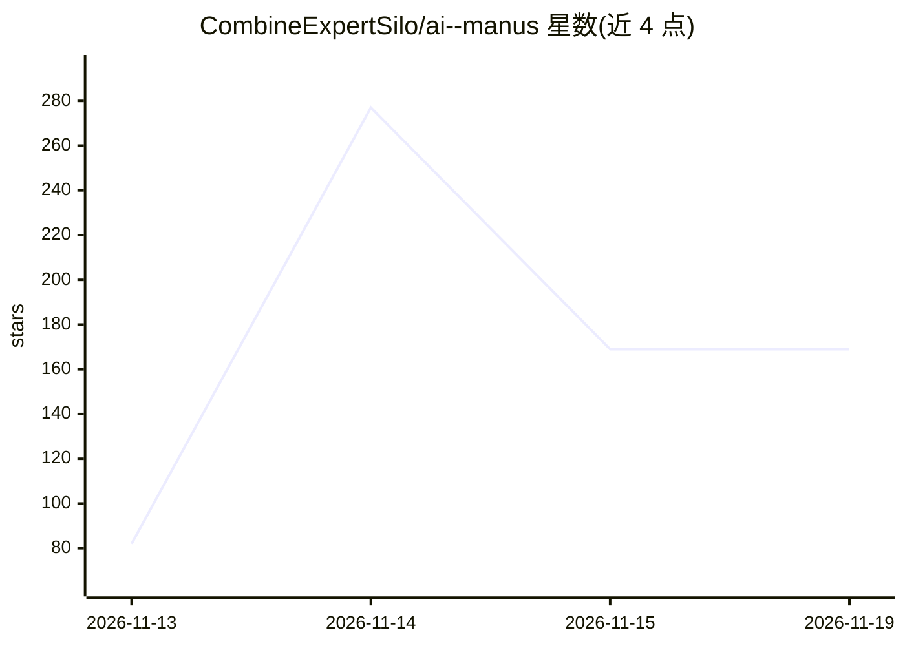

# CombineExpertSilo/ai--manus

⭐ 169 · Apache-2.0 · 推送 2026-11-15 · [GitHub](https://github.com/CombineExpertSilo/ai--manus) · 个人维护

**面向个人用户的通用自主 AI Agent：代写并执行代码、控制浏览器**

README 描述的 Manus 是一个自主 AI Agent：用户描述需求后，由 Agent 自主编写并执行脚本、打开网页并操作页面元素、完成多步骤任务，可用于学习研究、家庭项目与轻量办公。定位为面向非开发者的后台个人助手，非企业平台。README 给出兼容性表（最低双核 CPU、4 GB 内存）与使用步骤说明，但未提供任何安装命令、代码仓库结构或模型接入细节；文中出现的下载码 PROMO2026 无对应链接说明。

## 筛选速览

| 维度 | 判定 | 备注 |
|---|---|---|
| AI 角色 | `ai-native` | 本体是模型或模型工具 |
| 许可风险 | `permissive` | Apache-2.0 |
| 部署形态 | `None` |  |
| 模型依赖 | — | README 未给出锁定关系 |
| 硬件要求 | — | 无带数字的原话,不猜 |
| 安装摩擦 | `low` | 无编译、无系统依赖或容器化 |
| 成熟度 | — | 结构信号不足 |

## 能力要点

- 自主执行代码与浏览器控制可在同一任务流中衔接
- 面向多步骤任务，宣称跨会话保持一致行为
- 明确说明最低硬件要求（双核 CPU、4 GB 内存）

## 适用场景

- 让 Agent 代为查网页、填表单、收集资料
- 自动运行小脚本处理重复性事务
- 学习与轻量办公中委托多步骤小任务

## 场景标签

`AI 助手` `编码 Agent` `浏览器自动化` · 领域:效率与自动化

## 证据(README 行号)

> L10: - **Autonomous Code Execution:** Manus AI agent runs code on its own to complete tasks, so you can focus on decisio
> L18: Manus is an autonomous AI agent designed to run code and control a browser on your behalf. Instead of acting like a

## 星数曲线

2026-11-13 82 → 2026-11-19 169（+87）

---
*卡片 v1 · prompt 1.4 · 生成 2026-11-17 · 置信度 low · 依据 README sha `a3d88e202bf0` · [字段定义](../../DATASET.md)*
