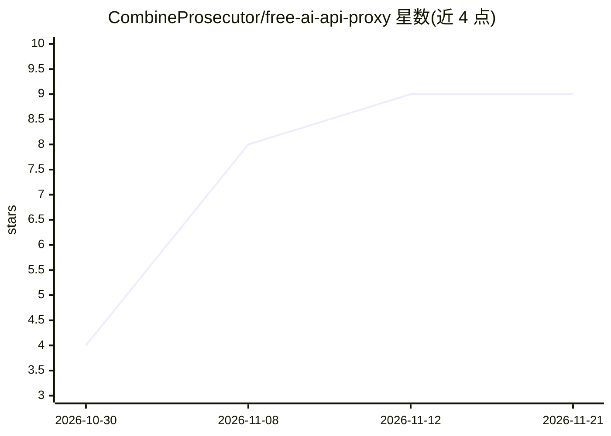

# CombineProsecutor/free-ai-api-proxy

⭐ 9 · Go · 推送 2026-10-21 · [GitHub](https://github.com/CombineProsecutor/free-ai-api-proxy) · 组织维护

**给开发者统一代理与路由多家 AI 模型请求的网关**

以单一标准化端点（/v1/chat/completions）聚合多家 AI 服务：按请求中的 model 参数将 OpenAI 格式翻译并转发到对应上游；遇 429/500 自动重试并回退备用模型；提供 key 轮换、token 统计与成本估算、日志与健康检查。通过 providers.yaml/routing.yaml 配置密钥、路由规则与降级链，支持语义路由、插件中间件、Web 仪表盘与 OpenTelemetry/Prometheus 指标。Go 实现，经 Docker 部署。README 未给出源码安装途径。

## 筛选速览

| 维度 | 判定 | 备注 |
|---|---|---|
| AI 角色 | `ai-ecosystem` | LLM/agent 周边工具 |
| 许可风险 | `none` | — |
| 部署形态 | `self-host` | docker 或自建部署 |
| 模型依赖 | — | README 未给出锁定关系 |
| 硬件要求 | — | 无带数字的原话,不猜 |
| 安装摩擦 | `low` | 无编译、无系统依赖或容器化 |
| 成熟度 | — | 结构信号不足 |

## 能力要点

- 统一 OpenAI 格式端点，按 model 参数翻译并转发请求
- 429/500 自动重试与备用模型回退机制
- API key 自动轮换以绕过速率限制
- YAML 配置路由规则，含语义路由与插件目录

## 适用场景

- 用一个端点接入多家模型服务并按配置切换模型
- 主模型限流或出错时自动回退到备用模型
- 按任务复杂度把请求路由到不同成本档位的模型
- 监控生产环境的请求日志、token 用量与服务健康

## 场景标签

`模型网关` · 领域:Agent 开发

## 证据(README 行号)

> L14: **FreeAiApiProxy** solves this chaos by providing a single, unified gateway to dozens of AI models. It acts as an i
> L52: When you send a prompt to the `/v1/chat/completions` endpoint, the proxy parses the requested model. If you request

## 星数曲线

2026-10-30 4 → 2026-11-21 9（+5）

---
*卡片 v1 · prompt 1.4 · 生成 2026-11-20 · 置信度 high · 依据 README sha `1d4920f028c1` · [字段定义](../../DATASET.md)*
