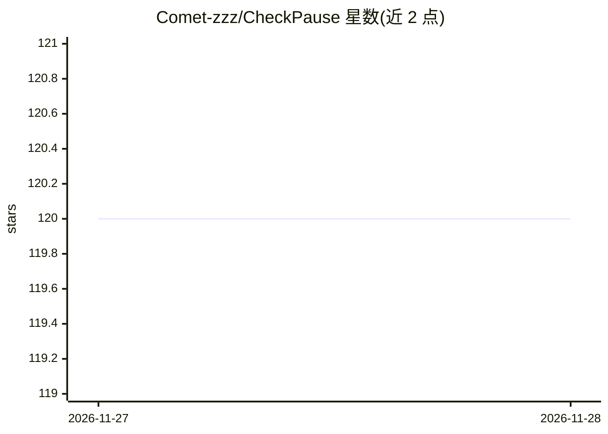

# Comet-zzz/CheckPause

⭐ 120 · Python · NOASSERTION · 推送 2026-11-27 · [GitHub](https://github.com/Comet-zzz/CheckPause) · [官网](https://checkpause.com) · 个人维护 · 中文 README

**免费国际象棋桌面工具：引擎分析+AI 语言讲解+训练**

基于 Stockfish 与 OpenAI 兼容模型的国际象棋桌面应用：逐步评分棋局、判定走法质量并给出准确率；将引擎数据作为上下文传给 LLM，用户可对任意走法用自然语言提问。另含习题训练、对弈（100–3000 分级）、基础课程与对局记录。提供 Windows 安装包与 macOS dmg，自带 Stockfish 与开局库，无需 Python。分析与棋盘功能无需 API key，仅 AI 问答需要；本产品为专有软件。

## 筛选速览

| 维度 | 判定 | 备注 |
|---|---|---|
| AI 角色 | `ai-enhanced` | 去掉 AI 部分产品仍成立 |
| 许可风险 | `none` | NOASSERTION |
| 部署形态 | `desktop` | 安装包/桌面程序 |
| 模型依赖 | — | README 未给出锁定关系 |
| 硬件要求 | — | 无带数字的原话,不猜 |
| 安装摩擦 | `low` | 无编译、无系统依赖或容器化 |
| 成熟度 | — | 结构信号不足 |

## 能力要点

- Stockfish 后台逐 ply 评分，走法判定含 Blunder 至 Brilliant 等类别
- 引擎数据传给 LLM，用自然语言解释走法，支持 OpenAI/OpenRouter/本地模型等 OpenAI 兼容端点
- 内置 Polyglot 开局库识别与 Lichess 习题数据（CC0）
- 本地分析不出机器，API key 存于本地 secrets.dat

## 适用场景

- 复盘自己的棋局，理解关键走法与决策偏差
- 离线训练习题并追踪准确率与主题表现
- 与不同等级的电脑对弈后一键转入分析

## 场景标签

 · 领域:游戏/棋类分析工具

## 证据(README 行号)

> L8: CheckPause uses Stockfish for analysis, then lets any OpenAI-compatible model translate the engine data into natural
> L81: > Analysis and board features work without an API key; only AI chat needs one.

## 星数曲线

2026-11-27 120 → 2026-11-28 120（+0）

---
*卡片 v1 · prompt 1.4 · 生成 2026-11-27 · 置信度 high · 依据 README sha `a2fc49c55182` · [字段定义](../../DATASET.md)*
