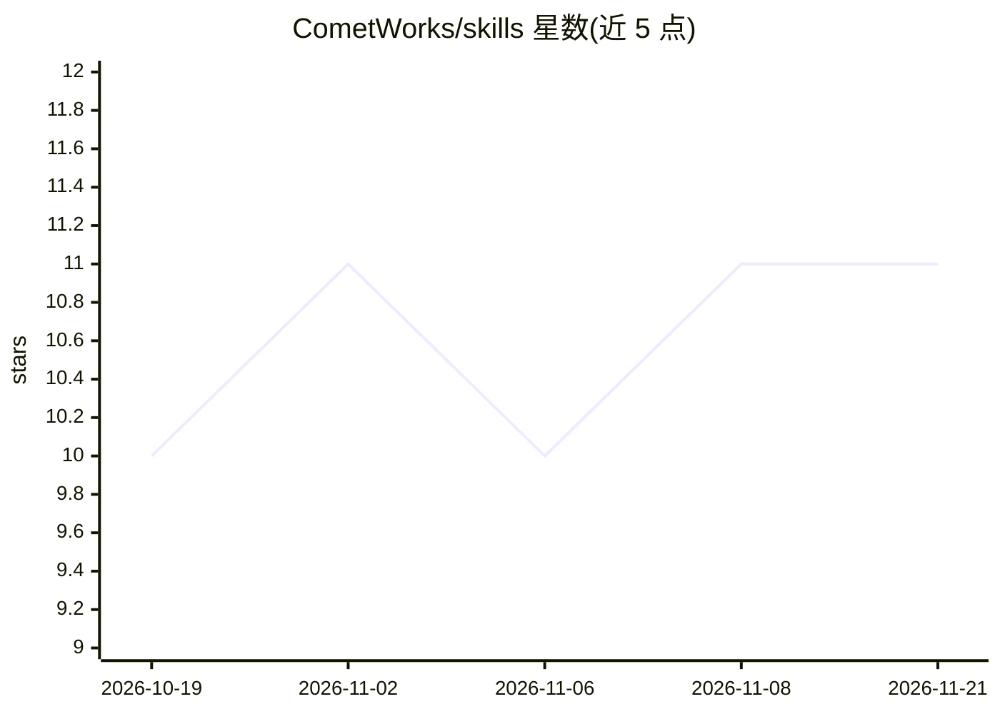

# CometWorks/skills

⭐ 11 · Python · MIT · 推送 2026-11-07 · [GitHub](https://github.com/CometWorks/skills) · 个人维护

**Space Engineers 插件/Mod/游戏内脚本开发的 AI 编码技能库**

面向 agentic 编码环境的技能集合，覆盖游戏内脚本、Mod、插件（Pulsar/Magnetar/Torch）开发，并附带反编译后的游戏与服务端 C# 代码索引以供检索。技能首次使用时自动准备：下载工具、反编译游戏、构建代码索引（完整仓库约 1.5 GB，反编译约需 5–15 分钟）。通过 npx skills 安装，或用仓库内脚本以 junction/symlink 手动装到 Claude Code、Kilo Code、Cline、OpenCode 等环境。仅适用于游戏版本 1。

## 筛选速览

| 维度 | 判定 | 备注 |
|---|---|---|
| AI 角色 | `ai-knowledge` | 知识聚合/清单类 |
| 许可风险 | `permissive` | MIT |
| 部署形态 | `desktop` | 安装包/桌面程序 |
| 模型依赖 | — | README 未给出锁定关系 |
| 硬件要求 | — | 无带数字的原话,不猜 |
| 安装摩擦 | `medium` | 含编译或系统依赖之一 |
| 成熟度 | — | 结构信号不足 |

## 能力要点

- 8 个技能覆盖脚本、Mod、插件（含 Torch）开发与 PR 审查
- 反编译游戏/服务端代码并建立可搜索索引
- 基于渐进式披露机制控制 agent 上下文加载
- 内置游戏版本 1.210.014 的 Mod/脚本 API 白名单

## 适用场景

- 为 Space Engineers 开发插件、Mod 或游戏内脚本时让编码 agent 参照官方 API
- 检索反编译后的游戏 C# 源码辅助实现
- 对 PluginHub/MagnetarHub 的 PR 做安全与质量审查

## 场景标签

`代码生成` `代码审查` · 领域:编码与开发

## 证据(README 行号)

> L3: skill library for Space Engineers plugin, mod, in-game script development.
> L9: Need "skills" compatible agentic coding environment.
> L117: It doesn't! Skills work on principle of **progressive disclosure**. Claude Code initially sees only top-level

## 星数曲线

2026-10-19 10 → 2026-11-21 11（+1）

---
*卡片 v1 · prompt 1.4 · 生成 2026-11-19 · 置信度 high · 依据 README sha `6dab023ee08f` · [字段定义](../../DATASET.md)*
