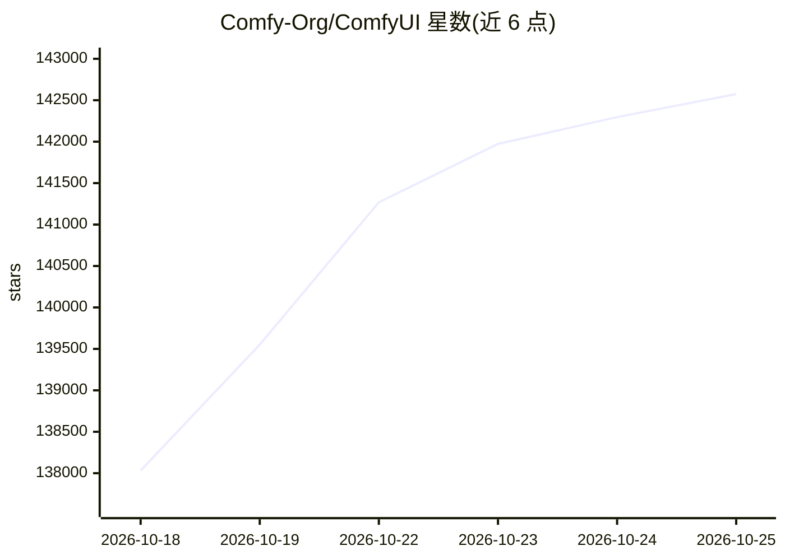

# Comfy-Org/ComfyUI

⭐ 142,875 · Python · GPL-3.0 · 推送 2026-10-25 · [GitHub](https://github.com/Comfy-Org/ComfyUI) · [官网](https://www.comfy.org/) · 组织维护

**给视觉创作者的节点式扩散模型 GUI 与本地推理后端**

以节点图组织图像、视频、音频、3D 与文本生成工作流的桌面/后端程序：支持加载 checkpoints、VAE、LoRA、ControlNet 等模型文件，工作流可存为 JSON，提供本地 API 与 App Mode 供集成到生产流水线。核心可完全离线运行（--offline 禁用付费 API 节点），通过异步权重流式在最低约 4GB 显存 + 8GB 内存的消费级硬件上运行大模型。Windows/macOS 提供桌面安装包与便携版，Linux 手动安装。

## 筛选速览

| 维度 | 判定 | 备注 |
|---|---|---|
| AI 角色 | `ai-native` | 本体是模型或模型工具 |
| 许可风险 | `viral` | GPL-3.0 |
| 部署形态 | `library` | 以包/库形式分发 |
| 模型依赖 | — | README 未给出锁定关系 |
| 硬件要求 | `gpu-8g` | |
| 安装摩擦 | `medium` | 含编译或系统依赖之一 |
| 成熟度 | — | 结构信号不足 |

## 动量与使用信号

- 维护:`active` — 距上次 push 0.6 天,年发版 74,344 位贡献者
- 涨星:近 1 天 **+229**(自 20261016 起算)
- 安装:pypi 包 `comfy-cli` 月下载 78,726
- 平台:WINDOWS / MACOS / LINUX · 协议:—

## 能力要点

- 节点图界面构建无代码的可复用生成工作流
- 原生支持 SD/Flux/Qwen/Wan/Hunyuan 等多类开源模型
- 异步权重流式与 VRAM/RAM 管理，支持量化模型
- 全平台覆盖：桌面应用、Windows 便携版、comfy-cli、手动安装

## 适用场景

- 在本地消费级 GPU 上生成与编辑图像、视频、音频
- 把工作流通过 API 集成到生产流水线
- 完全离线环境下运行扩散模型推理
- 加载与共享基于 JSON 的生成工作流

## 场景标签

`图像生成` `视频生成` `推理引擎` · 领域:内容生成

## 证据(README 行号)

> L16: ComfyUI is the AI creation engine for visual professionals who demand control over every model, every parameter, an
> L45: - A visual node graph for building and reusing image, video, audio, 3D, and text workflows without code.
> L123: # Installing

## 星数曲线

2026-10-18 138,032 → 2026-10-25 142,574（+4,542）

---
*卡片 v1 · prompt 1.4 · 生成 2026-10-18 · 置信度 high · 依据 README sha `1d9c36b3c039` · [字段定义](../../DATASET.md)*
