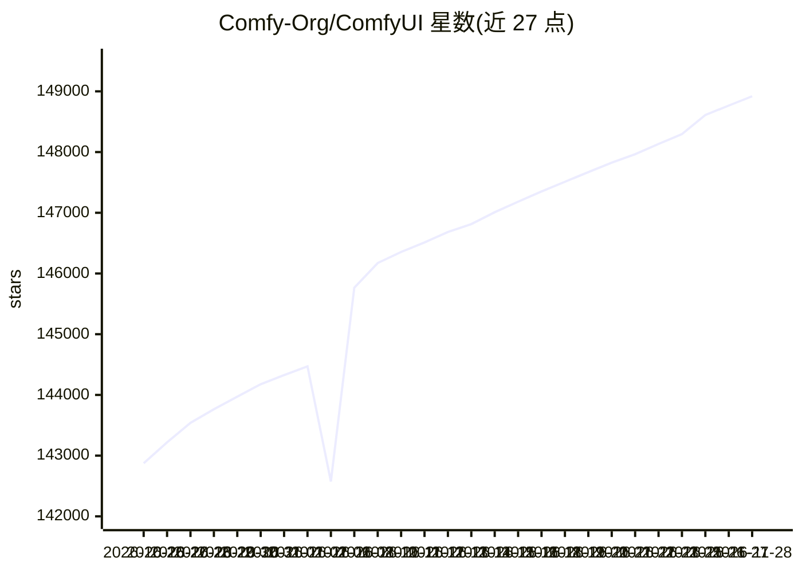

# Comfy-Org/ComfyUI

⭐ 148,919 · Python · GPL-3.0 · 推送 2026-11-27 · [GitHub](https://github.com/Comfy-Org/ComfyUI) · [官网](https://www.comfy.org/) · 组织维护

**节点图界面的扩散模型本地生成引擎，面向视觉创作者**

以浏览器/桌面节点图为界面的生成内容引擎：加载 checkpoint、VAE、LoRA、ControlNet 等模型文件，通过连线编排工作流生成图像、视频、音频与 3D 内容，并可将工作流发布为 API 端点。提供 Windows/macOS 安装包、便携版、CLI 与云端多形态；支持异步队列、显存/内存智能管理与量化模型，官方标注最低 4GB 显存 + 8GB 内存可运行大模型；通过 ComfyUI-Manager 安装自定义节点扩展，可完全离线运行。

## 筛选速览

| 维度 | 判定 | 备注 |
|---|---|---|
| AI 角色 | `ai-native` | 本体是模型或模型工具 |
| 许可风险 | `viral` | GPL-3.0 |
| 部署形态 | `library` | 以包/库形式分发 |
| 模型依赖 | — | README 未给出锁定关系 |
| 硬件要求 | `gpu-8g` | |
| 安装摩擦 | `low` | 无编译、无系统依赖或容器化 |
| 成熟度 | — | 结构信号不足 |

## 动量与使用信号

- 维护:`active` — 距上次 push 0.6 天,年发版 74,344 位贡献者
- 涨星:近 1 天 **+229**(自 20261016 起算)
- 安装:pypi 包 `comfy-cli` 月下载 78,726
- 平台:WINDOWS / MACOS / LINUX · 协议:—

## 能力要点

- 节点图构建图像/视频/音频/3D/文本工作流，无需代码
- 本地推理优化：异步权重流式、显存 offloading、量化模型支持
- 生成文件可拖回画布还原完整工作流（含种子）
- 多硬件后端：NVIDIA、AMD ROCm、Intel Arc、Apple Silicon、昇腾、寒武纪等

## 适用场景

- 本地用消费级显卡跑扩散模型生图生视频
- 把生成工作流部署成生产 API 端点接入应用
- 通过自定义节点扩展社区工作流
- 离线环境下进行内容生成工作

## 场景标签

`图像生成` · 领域:内容生成

## 证据(README 行号)

> L14: ComfyUI is the AI creation engine for visual professionals who demand control over every model, every parameter, an
> L26: - A visual node graph for building and reusing image, video, audio, 3D, and text workflows without code.
> L35: - Efficient local execution with asynchronous queueing, partial graph re-execution, smart VRAM and RAM management, 

## 星数曲线

2026-10-26 142,875 → 2026-11-28 148,919（+6,044）

---
*卡片 v1 · prompt 1.4 · 生成 2026-11-27 · 置信度 high · 依据 README sha `ac975c38139f` · [字段定义](../../DATASET.md)*
