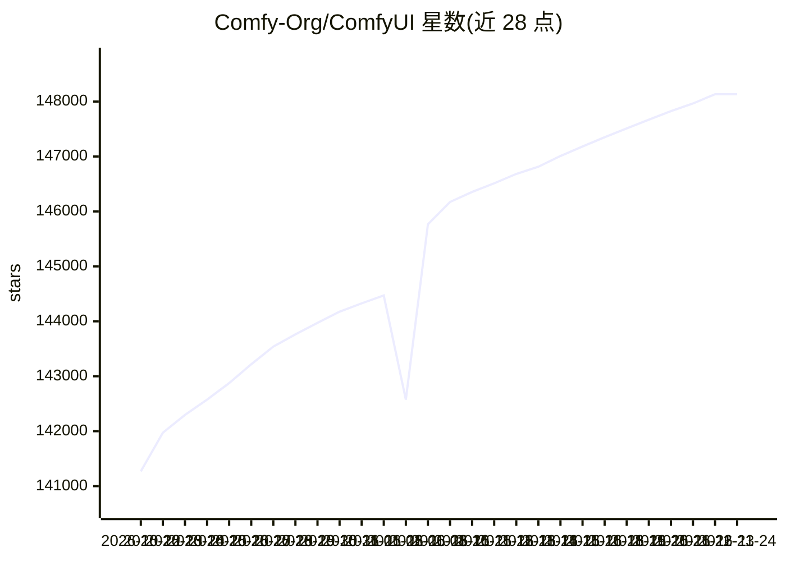

# Comfy-Org/ComfyUI

⭐ 148,295 · Python · GPL-3.0 · 推送 2026-11-24 · [GitHub](https://github.com/Comfy-Org/ComfyUI) · [官网](https://www.comfy.org/) · 组织维护

**给视觉创作者的节点图式扩散模型本地推理与生成引擎**

ComfyUI 是面向视觉创作者的 AI 内容生成引擎，通过节点图界面以无代码方式构建图像、视频、音频、3D 与文本生成工作流，原生支持 SD/Flux/Wan 等多系列开源模型，支持加载 checkpoint、VAE、LoRA、ControlNet 等格式，并提供局部重执行、VRAM/RAM 管理、异步权重流式等本地运行优化，可在低至 4GB 显存环境运行。另有 App Mode、API 端点、Comfy Agent 与 MCP 接入等形态，核心可完全离线运行，通过 ComfyUI-Manager 扩展自定义节点。

## 筛选速览

| 维度 | 判定 | 备注 |
|---|---|---|
| AI 角色 | `ai-native` | 本体是模型或模型工具 |
| 许可风险 | `viral` | GPL-3.0 |
| 部署形态 | `library` | 以包/库形式分发 |
| 模型依赖 | — | README 未给出锁定关系 |
| 硬件要求 | — | 无带数字的原话,不猜 |
| 安装摩擦 | `low` | 无编译、无系统依赖或容器化 |
| 成熟度 | — | 结构信号不足 |

## 动量与使用信号

- 维护:`active` — 距上次 push 0.6 天,年发版 74,344 位贡献者
- 涨星:近 1 天 **+229**(自 20261016 起算)
- 安装:pypi 包 `comfy-cli` 月下载 78,726
- 平台:WINDOWS / MACOS / LINUX · 协议:—

## 能力要点

- 节点图界面无代码构建图像/视频/音频/3D/文本工作流
- 原生支持 SD、Flux、Wan、Hunyuan 等多系列开源模型
- 异步权重流式技术支持低至 4GB 显存运行大模型
- 提供 Desktop/CLI/Cloud/API 端点/MCP 多种使用形态

## 适用场景

- 本地生成图像和视频并管理扩散模型工作流
- 通过 API 端点把工作流接入生产管线
- 无代码拖拽节点组合模型、LoRA 与 ControlNet
- 在消费级硬件上离线运行开源生成模型

## 场景标签

`图像生成` `视频生成` · 领域:内容生成

## 证据(README 行号)

> L14: ComfyUI is the AI creation engine for visual professionals who demand control over every model, every parameter, an
> L17: - It is by far the most optimized inference engine for diffusion models in the world with a focus on local consumer

## 星数曲线

2026-10-22 141,268 → 2026-11-24 148,133（+6,865）

---
*卡片 v1 · prompt 1.4 · 生成 2026-11-22 · 置信度 high · 依据 README sha `ff54d97c8714` · [字段定义](../../DATASET.md)*
