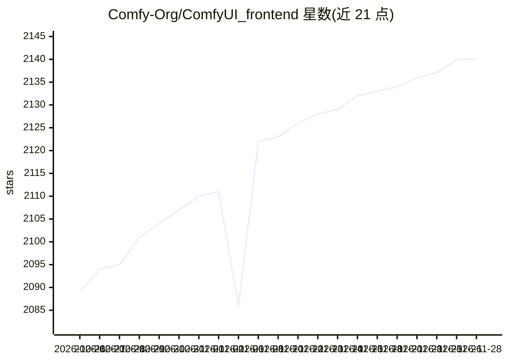

# Comfy-Org/ComfyUI_frontend

⭐ 2,140 · TypeScript · GPL-3.0 · 推送 2026-11-27 · [GitHub](https://github.com/Comfy-Org/ComfyUI_frontend) · [官网](https://www.comfy.org/) · 组织维护

**ComfyUI 官方前端：生成式 AI 节点工作流界面**

ComfyUI 的官方前端实现，为节点式生成式 AI 工作流提供界面：包含节点库侧边栏（拖放、过滤、模糊搜索）、队列/历史标签页、蒙版编辑器、集成服务端终端、快捷键自定义与画布交互（分组、连线自动转换、平移模式）等。内置 14 种语言的 i18n 翻译。为扩展开发者提供扩展 API（toast/对话框/设置/命令/侧边栏标签等注册接口）。采用三阶段发布流程（开发→冻结→发布），提供每日 nightly 版本，通过 ComfyUI 启动参数选用。

## 筛选速览

| 维度 | 判定 | 备注 |
|---|---|---|
| AI 角色 | `ai-ecosystem` | LLM/agent 周边工具 |
| 许可风险 | `viral` | GPL-3.0 |
| 部署形态 | `None` |  |
| 模型依赖 | — | README 未给出锁定关系 |
| 硬件要求 | — | 无带数字的原话,不猜 |
| 安装摩擦 | `low` | 无编译、无系统依赖或容器化 |
| 成熟度 | — | 结构信号不足 |

## 能力要点

- 节点库、队列/历史侧边栏与蒙版编辑器等界面能力
- 原生 i18n 支持 14 种界面语言
- 面向扩展开发者的扩展 API（toast、对话框、设置、命令、侧边栏标签）
- 结构化发布流程与每日 nightly 版本

## 适用场景

- 为 ComfyUI 用户操作节点工作流提供图形界面
- 为 ComfyUI 扩展开发者调用前端扩展 API
- 需要多语言界面（如简体中文）的 ComfyUI 使用者

## 场景标签

`图像生成` · 领域:内容生成

## 证据(README 行号)

> L3: **Official front-end implementation of ComfyUI.**
> L35: To use the latest nightly release, add the following command line argument to your ComfyUI launch script:
> L186: ### Developer APIs

## 星数曲线

2026-10-26 2,089 → 2026-11-28 2,140（+51）

---
*卡片 v1 · prompt 1.4 · 生成 2026-11-23 · 置信度 high · 依据 README sha `8392123b6e13` · [字段定义](../../DATASET.md)*
