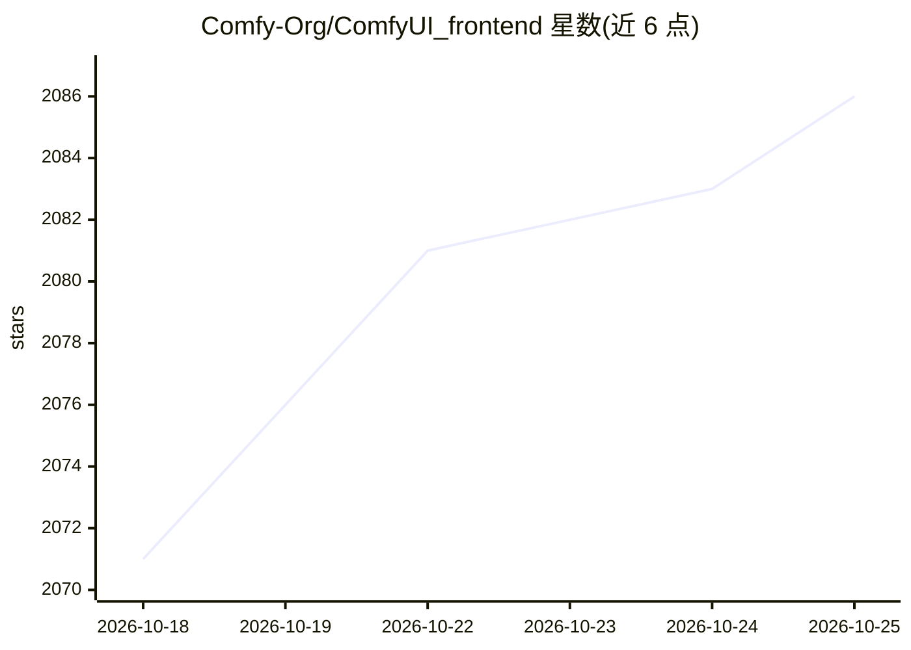

# Comfy-Org/ComfyUI_frontend

⭐ 2,089 · TypeScript · GPL-3.0 · 推送 2026-10-25 · [GitHub](https://github.com/Comfy-Org/ComfyUI_frontend) · [官网](https://www.comfy.org/) · 组织维护

**ComfyUI 官方前端实现：节点画布等图形界面**

Comfy-Org 维护的 ComfyUI 官方前端项目，提供节点图编辑（Litegraph 画布、分组、链接操作）、节点库与队列/历史侧栏、模糊搜索、快捷键自定义、内置服务器终端（Ctrl+`）及 14 种语言的原生翻译等功能。面向 ComfyUI 用户与扩展开发者，提供扩展注册 API（toast、命令、快捷键、侧栏标签、设置项等）。采用三阶段重叠的周期发布流程，每晚发布 nightly 版本，可通过 ComfyUI 启动参数 --front-end-version 指定版本。

## 筛选速览

| 维度 | 判定 | 备注 |
|---|---|---|
| AI 角色 | `ai-ecosystem` | LLM/agent 周边工具 |
| 许可风险 | `viral` | GPL-3.0 |
| 部署形态 | `None` |  |
| 模型依赖 | — | README 未给出锁定关系 |
| 硬件要求 | — | 无带数字的原话,不猜 |
| 安装摩擦 | `low` | 无编译、无系统依赖或容器化 |
| 成熟度 | — | 结构信号不足 |

## 能力要点

- Litegraph 节点画布编辑与多项 QoL 操作（分组、多选、自动连线）
- 原生 i18n 支持 14 种语言
- 面向扩展开发者的 API：toast、命令/快捷键、侧栏标签、设置项注册
- 每晚 nightly 发布，可经 --front-end-version 参数切换版本

## 适用场景

- 通过节点画布搭建和管理 ComfyUI 工作流
- 开发 ComfyUI 前端扩展并注册命令、面板与设置项
- 跟随 nightly 版本试用前端新功能

## 场景标签

`图像生成` · 领域:内容生成

## 证据(README 行号)

> L3: **Official front-end implementation of ComfyUI.**
> L372: ## Contributing

## 星数曲线

2026-10-18 2,071 → 2026-10-25 2,086（+15）

---
*卡片 v1 · prompt 1.4 · 生成 2026-10-21 · 置信度 high · 依据 README sha `8f43df6bb9d5` · [字段定义](../../DATASET.md)*
