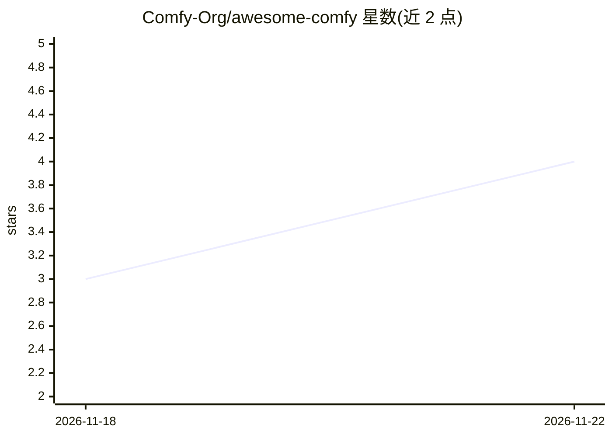

# Comfy-Org/awesome-comfy

⭐ 4 · CC0-1.0 · 推送 2026-11-11 · [GitHub](https://github.com/Comfy-Org/awesome-comfy) · 组织维护

**ComfyUI 生态资源清单：应用、影视案例、工作流与 SDK**

Comfy Org 维护的精选清单，收录用 ComfyUI 构建的工具、应用、成品、Workflow 与文档，每条一行加一个链接。内容分四部分：观看他人作品、运行 ComfyUI、在其上构建（API/SDK/Custom Node）、学习资源。条目按 From Comfy（官方团队）与 From the community（社区）标注来源，并声明不构成质量或安全审计，第三方条目以可执行代码形式运行，需自行审读后安装。

## 筛选速览

| 维度 | 判定 | 备注 |
|---|---|---|
| AI 角色 | `ai-knowledge` | 知识聚合/清单类 |
| 许可风险 | `viral` | CC0-1.0 |
| 部署形态 | `None` |  |
| 模型依赖 | — | README 未给出锁定关系 |
| 硬件要求 | — | 无带数字的原话,不猜 |
| 安装摩擦 | `medium` | 含编译或系统依赖之一 |
| 成熟度 | — | 结构信号不足 |

## 能力要点

- 收录影视、广告、游戏等成品案例，附制作方撰文链接
- 区分 From Comfy 与 From the community 两种来源标注
- 提供 ComfyUI 桌面安装包、CLI 管理器与 Workflow JSON 规范入口
- 声明清单不构成安全审计或背书，第三方 Custom Node 需自行审读

## 适用场景

- 了解 ComfyUI 在影视和商业项目中的应用方式
- 寻找把 ComfyUI 集成到 Krita/Blender/Photoshop 的插件
- 查找可运行的 Workflow 模板与 JSON 格式规范

## 场景标签

`精选清单` `图像生成` `工作流自动化` · 领域:效率与自动化

## 证据(README 行号)

> L11: |**What it is**|A curated list of tools, apps, finished work, Workflows and docs built with ComfyUI. Each entry is 
> L13: |**How it's organized**|Four parts: see what people make, run it, build on it, and learn. Inside most sections, **F

## 星数曲线

2026-11-18 3 → 2026-11-22 4（+1）

---
*卡片 v1 · prompt 1.4 · 生成 2026-11-22 · 置信度 high · 依据 README sha `24817cd038e1` · [字段定义](../../DATASET.md)*
