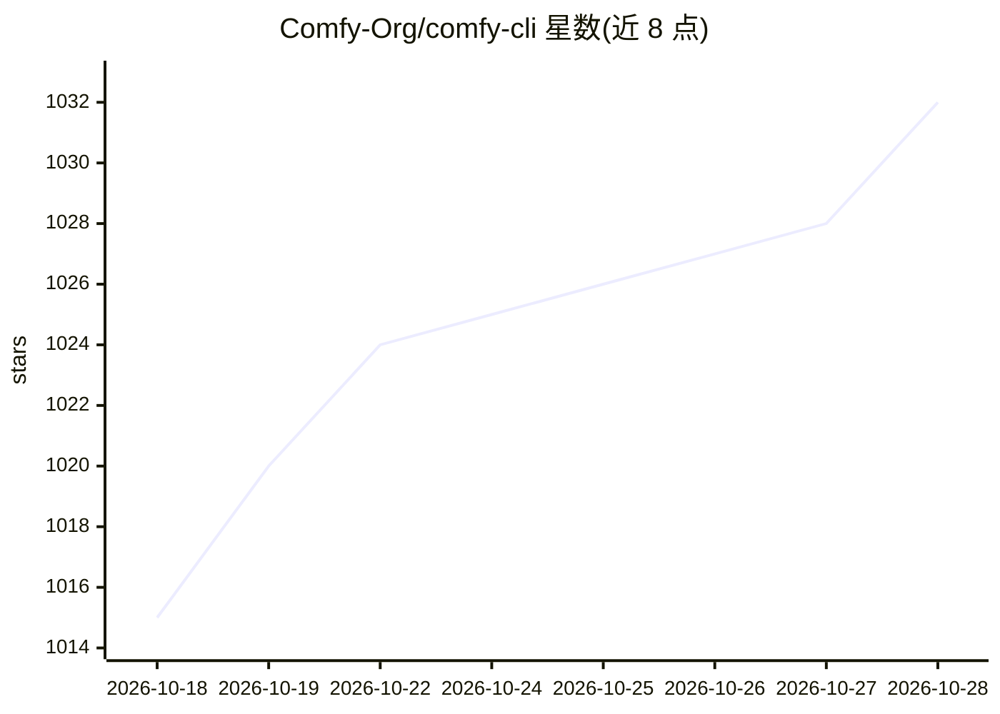

# Comfy-Org/comfy-cli

⭐ 1,034 · Python · GPL-3.0 · 推送 2026-10-28 · [GitHub](https://github.com/Comfy-Org/comfy-cli) · [官网](https://docs.comfy.org/comfy-cli/getting-started) · 组织维护

**ComfyUI 的命令行工具：安装、运行与管理生成式工作流**

Comfy-Org 官方维护的 ComfyUI 命令行工具：一条命令安装并启动 ComfyUI，管理自定义节点（安装/更新/快照/bisect），从 CivitAI、Hugging Face 或直链下载模型，在本地 ComfyUI 服务器上运行工作流（自动转换 UI 格式 JSON），或用 --where cloud 将工作流提交到 Comfy Cloud（消耗积分、需订阅）。还支持 comfy generate 直接调用 Flux、DALL·E、Runway 等合作模型节点。要求 Python 3.10+，通过 pip 安装，支持 Windows/macOS/Linux。

## 筛选速览

| 维度 | 判定 | 备注 |
|---|---|---|
| AI 角色 | `ai-ecosystem` | LLM/agent 周边工具 |
| 许可风险 | `viral` | GPL-3.0 |
| 部署形态 | `library` | 以包/库形式分发 |
| 模型依赖 | — | README 未给出锁定关系 |
| 硬件要求 | — | 无带数字的原话,不猜 |
| 安装摩擦 | `low` | 无编译、无系统依赖或容器化 |
| 成熟度 | — | 结构信号不足 |

## 能力要点

- 一条命令安装/启动/更新 ComfyUI（含版本切换与回滚）
- 自定义节点管理：安装、更新、快照、bisect
- 工作流可路由到 Comfy Cloud 云端运行，无本地 GPU 也可用
- 每条命令输出结构化 --json 信封，适配 agent 调用

## 适用场景

- 在终端完成 ComfyUI 的安装、升级与版本回滚
- 批量安装和更新自定义节点与模型文件
- 无本地 GPU 时把工作流提交到云端运行
- 在脚本或 agent 中以 JSON 输出驱动 ComfyUI 流程

## 场景标签

`图像生成` · 领域:内容生成

## 证据(README 行号)

> L10: comfy-cli is a command-line tool for installing, running, and extending
> L21: - 🚀 One-command ComfyUI install and launch
> L26: - 🎬 Run workflows against a local ComfyUI server, including auto-conversion of UI-format JSON

## 星数曲线

2026-10-18 1,015 → 2026-10-28 1,032（+17）

---
*卡片 v1 · prompt 1.4 · 生成 2026-10-21 · 置信度 high · 依据 README sha `1b88ab6a6518` · [字段定义](../../DATASET.md)*
