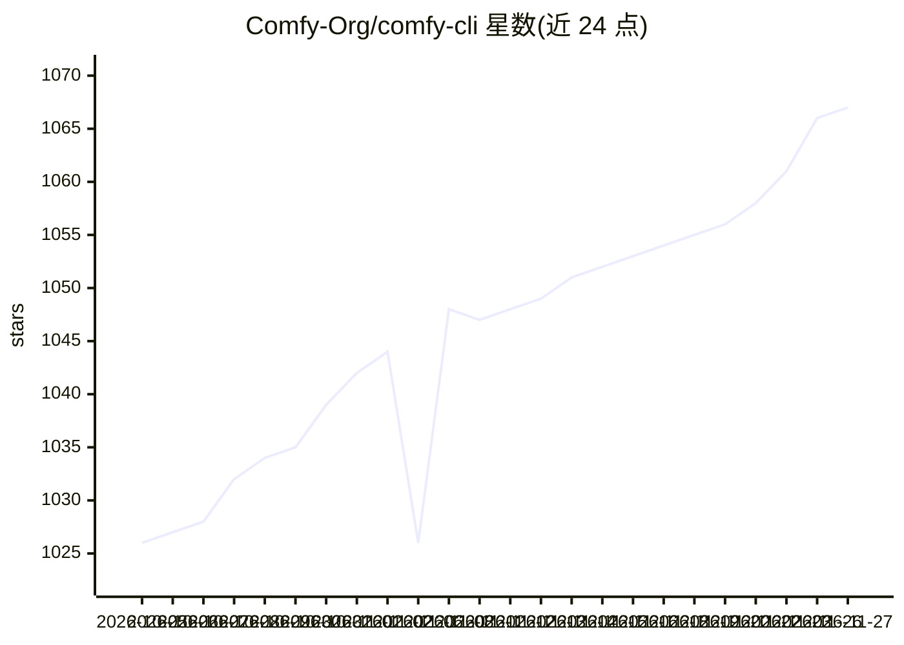

# Comfy-Org/comfy-cli

⭐ 1,067 · Python · GPL-3.0 · 推送 2026-11-26 · [GitHub](https://github.com/Comfy-Org/comfy-cli) · [官网](https://docs.comfy.org/comfy-cli/getting-started) · 组织维护

**安装、运行和扩展 ComfyUI 的命令行工具**

comfy-cli 提供 ComfyUI 的终端工作流：一条命令完成 ComfyUI 与 ComfyUI-Manager 的安装与启动，管理自定义节点（安装/更新/快照/二分定位）、从 CivitAI 与 Hugging Face 下载模型、对本地服务器运行工作流，或经 --where cloud 路由到 Comfy Cloud（消耗订阅 credits）。支持 pip/pipx/uv tool 安装，Python 3.10+，跨 Windows/macOS/Linux。命令输出结构化 --json 信封，附带供 Claude/Cursor 驱动 comfy 的技能包。

## 筛选速览

| 维度 | 判定 | 备注 |
|---|---|---|
| AI 角色 | `ai-ecosystem` | LLM/agent 周边工具 |
| 许可风险 | `viral` | GPL-3.0 |
| 部署形态 | `library` | 以包/库形式分发 |
| 模型依赖 | — | README 未给出锁定关系 |
| 硬件要求 | — | 无带数字的原话,不猜 |
| 安装摩擦 | `low` | 无编译、无系统依赖或容器化 |
| 成熟度 | — | 结构信号不足 |

## 能力要点

- 一条命令安装并启动 ComfyUI 与 ComfyUI-Manager
- comfy generate 直接调用合作方图像/视频节点（Flux、Ideogram、DALL·E 等）
- 自定义节点管理：安装、更新、快照、bisect
- 每个命令输出结构化 --json 信封，附带 Claude/Cursor 可用的技能

## 适用场景

- 在终端一站式安装、更新、启动 ComfyUI
- 批量管理 ComfyUI 自定义节点与模型下载
- 无本地 GPU 时将工作流提交到 Comfy Cloud 运行
- 编写脚本或让编程 Agent 驱动 ComfyUI 操作

## 场景标签

 · 领域:开发工具/生成媒体工作流

## 证据(README 行号)

> L10: comfy-cli is a command-line tool for installing, running, and extending
> L22: - 🎨 Direct calls to partner image and video nodes (Flux, Ideogram, DALL·E, Recraft, Reve, Gemini/nano-banana, Kling
> L29: - ☁️ Route any workflow to **Comfy Cloud** with `--where cloud` (no GPU required)

## 星数曲线

2026-10-25 1,026 → 2026-11-27 1,067（+41）

---
*卡片 v1 · prompt 1.4 · 生成 2026-11-26 · 置信度 high · 依据 README sha `a5c2f728acc2` · [字段定义](../../DATASET.md)*
