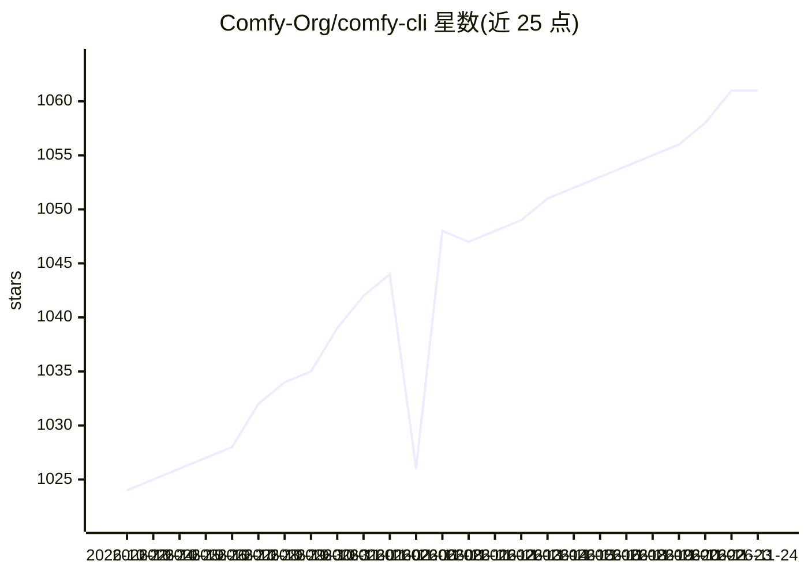

# Comfy-Org/comfy-cli

⭐ 1,061 · Python · GPL-3.0 · 推送 2026-11-22 · [GitHub](https://github.com/Comfy-Org/comfy-cli) · [官网](https://docs.comfy.org/comfy-cli/getting-started) · 组织维护

**给 ComfyUI 用户的命令行工具：安装、运行、管理节点与工作流**

comfy-cli 是面向 ComfyUI 的命令行工具，覆盖从安装到运行的完整流程：一条命令安装并启动 ComfyUI 与 ComfyUI-Manager，管理自定义节点（安装、更新、快照、二分定位），从 CivitAI、Hugging Face 与直链下载模型，对本地服务器运行工作流并自动转换 UI 格式 JSON。支持路由到 Comfy Cloud（`--where cloud`，消费订阅 credits），通过 `comfy generate` 直接调用伙伴图像/视频节点。每条命令输出结构化 `--json`，附带技能文件供 Claude/Cursor 驱动。跨平台支持 Windows/macOS/Linux，需 Python 3.10+。

## 筛选速览

| 维度 | 判定 | 备注 |
|---|---|---|
| AI 角色 | `ai-ecosystem` | LLM/agent 周边工具 |
| 许可风险 | `viral` | GPL-3.0 |
| 部署形态 | `library` | 以包/库形式分发 |
| 模型依赖 | — | README 未给出锁定关系 |
| 硬件要求 | — | 无带数字的原话,不猜 |
| 安装摩擦 | `low` | 无编译、无系统依赖或容器化 |
| 成熟度 | — | 结构信号不足 |

## 能力要点

- 一条命令安装并启动 ComfyUI 与 ComfyUI-Manager
- 自定义节点管理：安装、更新、快照、bisect
- 运行工作流并自动转换 UI 格式 JSON，支持路由到 Comfy Cloud
- 每条命令输出结构化 --json，附带供 Claude/Cursor 使用的技能

## 适用场景

- 用命令行方式安装、启动和管理本地 ComfyUI 工作区
- 批量安装与回滚自定义节点（快照/版本切换）
- 无本地 GPU 时把工作流提交到 Comfy Cloud 执行
- 在脚本/CI 中以 JSON 输出驱动 ComfyUI 操作

## 场景标签

`图像生成` · 领域:内容生成

## 证据(README 行号)

> L10: comfy-cli is a command-line tool for installing, running, and extending
> L12: generative-media engine. Set up ComfyUI, install custom nodes and models, run
> L30: - 🤖 Agent-friendly: every command emits structured `--json` envelopes

## 星数曲线

2026-10-22 1,024 → 2026-11-24 1,061（+37）

---
*卡片 v1 · prompt 1.4 · 生成 2026-11-24 · 置信度 high · 依据 README sha `71b966741f14` · [字段定义](../../DATASET.md)*
