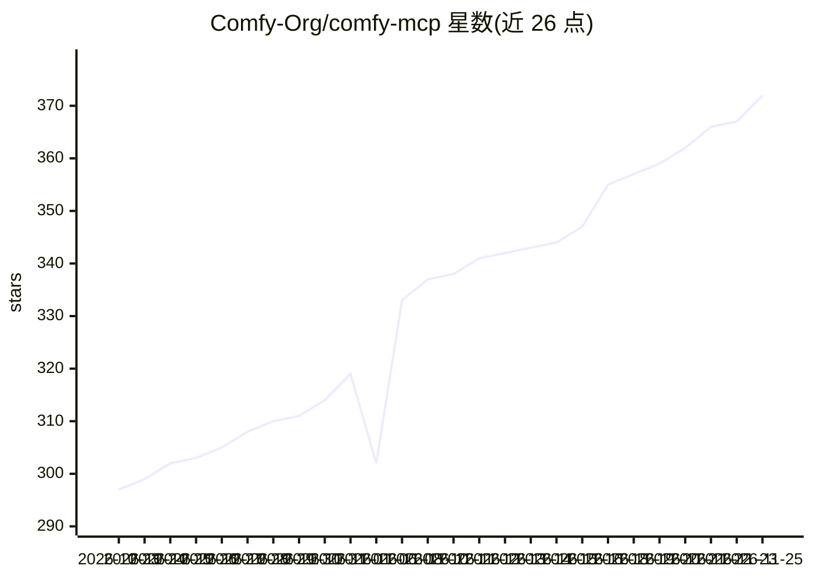

# Comfy-Org/comfy-mcp

⭐ 372 · Python · NOASSERTION · 推送 2026-11-24 · [GitHub](https://github.com/Comfy-Org/comfy-mcp) · 组织维护

**让 AI agent 通过 MCP 驱动本地 ComfyUI 的服务器**

基于 comfy-cli 构建的本地 MCP 服务器（stdio），把 42 个工具暴露给支持 MCP 的客户端。工具覆盖工作流执行（API 格式或 UI 导出 JSON）、异步任务监控与取消、输出文件收集、视频/音频的接触表与波形预览、对实际安装中节点/模型/模板的检索、工作流校验与变体派生，以及 ComfyUI 服务的启动/停止/日志查看。每个工具调用 `comfy --where local` 命令并解析 envelope 输出，默认指向本机 127.0.0.1:8188 的 ComfyUI；部分流程可调用托管 partner 模型。状态为 beta。

## 筛选速览

| 维度 | 判定 | 备注 |
|---|---|---|
| AI 角色 | `ai-ecosystem` | LLM/agent 周边工具 |
| 许可风险 | `dual` | NOASSERTION |
| 部署形态 | `desktop` | 安装包/桌面程序 |
| 模型依赖 | — | README 未给出锁定关系 |
| 硬件要求 | — | 无带数字的原话,不猜 |
| 安装摩擦 | `medium` | 含编译或系统依赖之一 |
| 成熟度 | `idea` | |

## 能力要点

- 42 个 MCP 工具：生成、任务监控、媒体预览、环境检索、工作流构建
- 每个工具经 comfy-cli 的 `--where local --json` 调用并解析 envelope/1 输出
- 检索的是本机实际安装的节点/模型/模板（含自定义节点）
- 支持 Claude Code / Claude Desktop / Cursor 三种客户端的配置示例

## 适用场景

- 让 Claude Code 等 agent 直接运行本地 ComfyUI 工作流出图
- 用自然语言让 agent 从模板搜索并组装可运行的工作流
- 远程监控、取消任务并收集输出文件到指定目录

## 场景标签

`图像生成` · 领域:内容生成

## 证据(README 行号)

> L33: Each tool shells out to the `comfy` command with `--where local --json`, parses comfy-cli's
> L5: **Drive your own ComfyUI from Claude Code, Claude Desktop, Cursor, or any MCP-speaking AI agent — an MCP server buil
> L13:  License: AGPL-3.0-or-later OR Commercial

## 星数曲线

2026-10-23 297 → 2026-11-25 372（+75）

---
*卡片 v1 · prompt 1.4 · 生成 2026-11-25 · 置信度 high · 依据 README sha `84643ddff596` · [字段定义](../../DATASET.md)*
