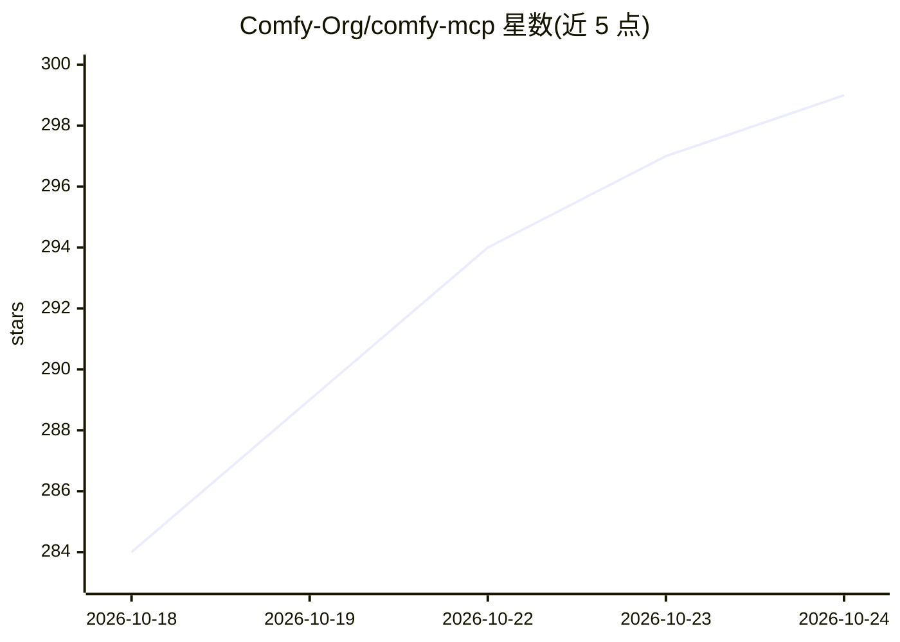

# Comfy-Org/comfy-mcp

⭐ 299 · Python · NOASSERTION · 推送 2026-10-22 · [GitHub](https://github.com/Comfy-Org/comfy-mcp) · 组织维护

**让 AI agent 通过 MCP 驱动本地 ComfyUI 的服务器**

基于 comfy-cli 构建的 stdio MCP 服务器，供 Claude Code、Claude Desktop、Cursor 等 MCP 客户端调用，操作用户本机的 ComfyUI（127.0.0.1:8188）。提供 40 个工具：运行工作流 JSON 或文本生成图像、异步任务监控、检索本地已装节点/模型/模板、校验与编辑工作流、启动/停止 ComfyUI 及管理输入资产；每个工具调用 comfy 命令并解析其 envelope/1 输出。comfy-cli 非声明依赖，需 PATH 或 COMFY_BIN 指向。自称 beta 状态，CI 覆盖 Python 3.10/3.14。

## 筛选速览

| 维度 | 判定 | 备注 |
|---|---|---|
| AI 角色 | `ai-ecosystem` | LLM/agent 周边工具 |
| 许可风险 | `dual` | NOASSERTION |
| 部署形态 | `library` | 以包/库形式分发 |
| 模型依赖 | locked-api |  |
| 硬件要求 | — | 无带数字的原话,不猜 |
| 安装摩擦 | `low` | 无编译、无系统依赖或容器化 |
| 成熟度 | `idea` | |

## 能力要点

- 40 个工具覆盖生成、任务监控、节点/模型检索、工作流构建与 ComfyUI 管理
- 基于 comfy-cli 引擎，默认指向本机 127.0.0.1:8188 的 ComfyUI
- stdio 服务器形式，支持 Claude Code / Claude Desktop / Cursor 配置接入
- partner_generate 等流程可调用 Flux / Ideogram / Kling 等托管合作模型

## 适用场景

- 在 Claude Code 或 Cursor 中用自然语言运行本地 ComfyUI 工作流生成图像
- 让 agent 检索本机实际安装的节点、模型与模板
- 通过 agent 异步提交任务并收集输出 PNG

## 场景标签

`图像生成` · 领域:内容生成

## 证据(README 行号)

> L5: **Drive your own ComfyUI from Claude Code, Claude Desktop, Cursor, or any MCP-speaking AI agent — an MCP server buil
> L32: Each tool shells out to the `comfy` command with `--where local --json`, parses comfy-cli's
> L44: normal. This one is **stdio**: your client launches it as a subprocess on **your own machine**, and

## 星数曲线

2026-10-18 284 → 2026-10-24 299（+15）

---
*卡片 v1 · prompt 1.4 · 生成 2026-10-22 · 置信度 high · 依据 README sha `34631146e705` · [字段定义](../../DATASET.md)*
