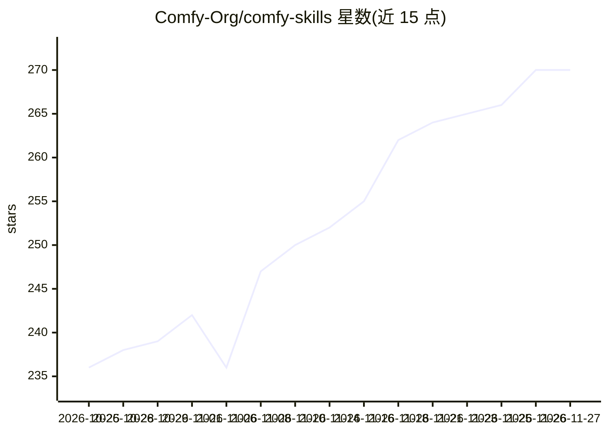

# Comfy-Org/comfy-skills

⭐ 270 · MIT · 推送 2026-11-23 · [GitHub](https://github.com/Comfy-Org/comfy-skills) · 组织维护

**让 AI 编码代理调用 Comfy Cloud 生成图像/视频/音频/3D 的技能插件**

为 AI 编码代理提供 Comfy Cloud 技能与 MCP 连接的仓库：comfy-cloud 插件托管 MCP 服务器并捆绑 12 个 Agent Skills（图像、视频、语音克隆、3D、模型/节点/模板搜索等），可通过斜杠命令或自然语言在 Claude chat、Cowork、Claude Code 三端加载；comfy-sdk 插件仅提供在 Comfy SDK 与 Comfy Router 上构建应用的指导文件，可复制到 Cursor 规则或 AGENTS.md。使用需 OAuth 登录，chat 插件需付费 Claude 计划。

## 筛选速览

| 维度 | 判定 | 备注 |
|---|---|---|
| AI 角色 | `ai-ecosystem` | LLM/agent 周边工具 |
| 许可风险 | `permissive` | MIT |
| 部署形态 | `None` |  |
| 模型依赖 | — | README 未给出锁定关系 |
| 硬件要求 | — | 无带数字的原话,不猜 |
| 安装摩擦 | `low` | 无编译、无系统依赖或容器化 |
| 成熟度 | — | 结构信号不足 |

## 能力要点

- comfy-cloud 插件一步安装 MCP 连接与 Agent Skills，三端共享
- 12 个技能覆盖图像/视频/音频生成、语音克隆、3D、背景移除、图像放大与目录搜索
- comfy-sdk 为单文件技能，可复制到 Cursor rules 或 AGENTS.md
- 编写规则要求技能分层：稳定引导冻结、运行时细节由工具实时发现

## 适用场景

- 在 Claude Code 中用斜杠命令生成或编辑图像、视频、音频
- 让代理搜索 Comfy 模型、节点与工作流模板
- 在 Comfy SDK 上构建应用时让代理遵循调用规范

## 场景标签

`图像生成` `语音合成` `视频生成` · 领域:内容生成

## 证据(README 行号)

> L5: Home of **Comfy skills and plugins for AI coding agents**. **`comfy-cloud`** is the Agent Skills and MCP connection 
> L11: The **`comfy-cloud`** plugin bundles the Comfy Cloud MCP connection **and** Agent Skills in one step. The same plug

## 星数曲线

2026-10-25 236 → 2026-11-27 270（+34）

---
*卡片 v1 · prompt 1.4 · 生成 2026-11-25 · 置信度 high · 依据 README sha `b44f254200c8` · [字段定义](../../DATASET.md)*
