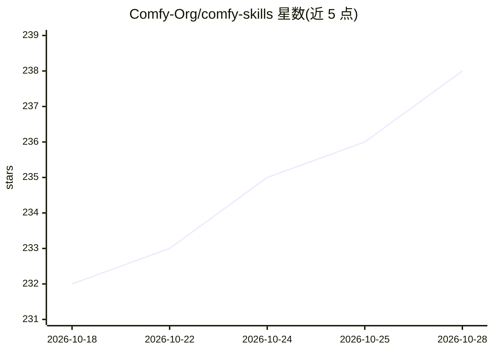

# Comfy-Org/comfy-skills

⭐ 238 · MIT · 推送 2026-10-23 · [GitHub](https://github.com/Comfy-Org/comfy-skills) · 组织维护

**让 AI 编码 agent 通过 Comfy Cloud 生成图像/视频/音频/3D 的插件与 MCP 服务器**

Comfy 官方维护的 Claude Code 插件仓库：comfy-cloud 插件一步捆绑托管 MCP 服务器（cloud.comfy.org/mcp，OAuth 登录）与 12 个斜杠命令，覆盖生成/编辑图像、视频、音频、3D 模型、抠图、放大、搜索模型/节点/模板等。命令遵循两层编写规则：安装时冻结稳定策略、运行时通过工具动态发现模型与模板。旧版 skills/ 平铺文件对应的 curl 安装器已弃用并将移除。其他客户端（Claude Desktop 等）可通过各自配置连接同一 MCP 服务器。

## 筛选速览

| 维度 | 判定 | 备注 |
|---|---|---|
| AI 角色 | `ai-ecosystem` | LLM/agent 周边工具 |
| 许可风险 | `permissive` | MIT |
| 部署形态 | `None` |  |
| 模型依赖 | — | README 未给出锁定关系 |
| 硬件要求 | — | 无带数字的原话,不猜 |
| 安装摩擦 | `low` | 无编译、无系统依赖或容器化 |
| 成熟度 | — | 结构信号不足 |

## 能力要点

- 单插件同时注册托管 MCP 服务器与斜杠命令
- 12 个命令覆盖图像/视频/音频/3D 生成与模型、节点、模板搜索
- 命令编写规则：冻结策略、运行时动态发现（避免硬编码模型名等易腐事实）
- skills/ 旧版平铺布局对应已弃用的 curl 安装器，计划移除

## 适用场景

- 在 Claude Code 里用自然语言让 agent 生成或编辑图像/视频/音频/3D
- agent 运行时搜索 Comfy Cloud 可用的模型、节点与工作流模板
- 通过 MCP 协议让其他客户端接入 Comfy Cloud 生成能力

## 场景标签

`图像生成` `视频生成` · 领域:内容生成

## 证据(README 行号)

> L5: Home of **Comfy Cloud skills and plugins for AI coding agents** — the slash commands and MCP connection that let an 
> L11: The **`comfy-cloud`** plugin bundles the Comfy Cloud MCP connection **and** the slash commands in one step:

## 星数曲线

2026-10-18 232 → 2026-10-28 238（+6）

---
*卡片 v1 · prompt 1.4 · 生成 2026-10-22 · 置信度 high · 依据 README sha `acc35cf0a072` · [字段定义](../../DATASET.md)*
