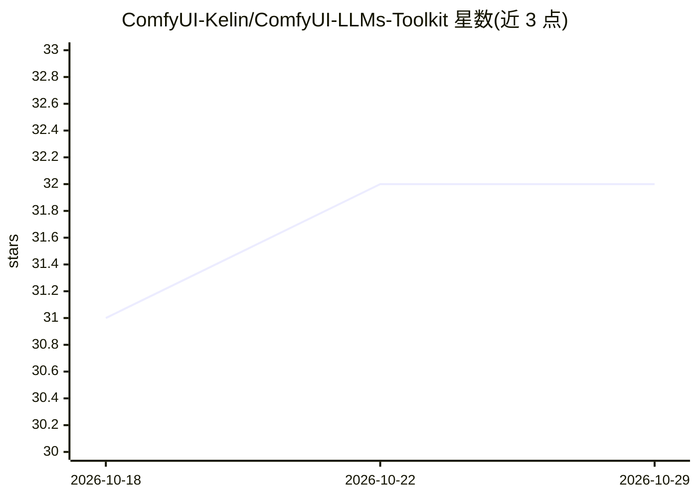

# ComfyUI-Kelin/ComfyUI-LLMs-Toolkit

⭐ 32 · Python · AGPL-3.0 · 推送 2026-04-23 · [GitHub](https://github.com/ComfyUI-Kelin/ComfyUI-LLMs-Toolkit) · 组织维护 · 中文 README

**在 ComfyUI 中调用 OpenAI 兼容 LLM API 的自定义节点包**

面向 ComfyUI 用户的自定义节点包：通过 OpenAI 兼容 API 接入 DeepSeek、Qwen、GLM、GPT 等 12 个预配置服务商，提供可视化 Provider Manager 管理密钥与模型，节点覆盖对话、多轮记忆、翻译、图像理解与 JSON 构建/修复等。API 密钥存储在本地 config/providers.json；API 调用失败时返回可读错误而非中断工作流。可通过 ComfyUI Manager 或 git clone 手动安装；本地模型（如 Ollama）可经自定义 Base URL 接入。

## 筛选速览

| 维度 | 判定 | 备注 |
|---|---|---|
| AI 角色 | `ai-ecosystem` | LLM/agent 周边工具 |
| 许可风险 | `viral` | AGPL-3.0 |
| 部署形态 | `library` | 以包/库形式分发 |
| 模型依赖 | local-ok | 支持本地模型 |
| 硬件要求 | — | 无带数字的原话,不猜 |
| 安装摩擦 | `low` | 无编译、无系统依赖或容器化 |
| 成熟度 | — | 结构信号不足 |

## 能力要点

- 12 个预配置服务商（Qwen/DeepSeek/GLM/豆包/Moonshot 等），可视化 Provider Manager
- OpenAI Compatible Adapter 节点支持系统提示词、多轮记忆与视觉输入
- JSON Builder/Combine/Extractor/Fixer 四个结构化数据处理节点
- 任何 OpenAI 兼容端点（含本地 Ollama）可作为自定义 Provider 接入

## 适用场景

- 在 ComfyUI 工作流中调用云端 LLM 做提示词生成与翻译，无需本地 GPU 模型
- 用多模态模型在图像工作流中做图像理解
- 生成并修复结构化 JSON 供下游节点使用

## 场景标签

`模型网关` `多模态` · 领域:Agent 开发

## 证据(README 行号)

> L20: ComfyUI-LLMs-Toolkit is a ComfyUI custom node pack for connecting DeepSeek, Qwen, GPT, Moonshot, and other OpenAI-c
> L22: Use it to build LLM-powered ComfyUI workflows for prompt generation, translation, structured JSON output, image und

## 星数曲线

2026-10-18 31 → 2026-10-29 32（+1）

---
*卡片 v1 · prompt 1.4 · 生成 2026-10-26 · 置信度 mid · 依据 README sha `0e15b93e2faa` · [字段定义](../../DATASET.md)*
