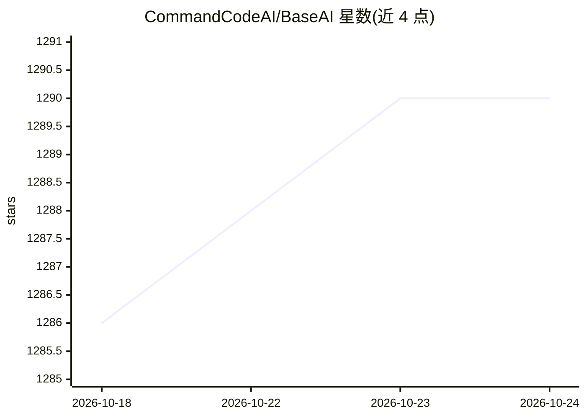

# CommandCodeAI/BaseAI

⭐ 1,290 · TypeScript · NOASSERTION · 推送 2026-05-16 · [GitHub](https://github.com/CommandCodeAI/BaseAI) · [官网](https://BaseAI.dev) · 组织维护

**构建 Serverless AI Agent 的 TypeScript Web 框架（已归档）**

BaseAI 是 TypeScript-first 的 AI 框架，用于在本地构建带工具与记忆（RAG）的 AI agent pipes，通过 npx 命令初始化项目、创建 pipe、本地运行 BaseAI 服务器，再以 @baseai/core 在应用中集成流式调用，支持一条命令部署 serverless。仓库 README 声明项目已归档，转向 Langbase AI Primitives，作者认为 AI 工程快速演进中框架会成为阻碍，建议改用提供 API 与 TS/Python SDK 的 AI 原语。原作者是 Langbase 团队的四名成员。

## 筛选速览

| 维度 | 判定 | 备注 |
|---|---|---|
| AI 角色 | `ai-ecosystem` | LLM/agent 周边工具 |
| 许可风险 | `none` | NOASSERTION |
| 部署形态 | `library` | 以包/库形式分发 |
| 模型依赖 | — | README 未给出锁定关系 |
| 硬件要求 | — | 无带数字的原话,不猜 |
| 安装摩擦 | `low` | 无编译、无系统依赖或容器化 |
| 成熟度 | — | 结构信号不足 |

## 能力要点

- TypeScript-first，npx baseai init 一条命令初始化项目
- Pipe 形式定义 AI agent，可编辑系统提示与模型参数
- 本地运行 BaseAI 服务器，支持本地 RAG 与流式输出
- README 声明已归档，转向 Langbase AI Primitives

## 适用场景

- 在本地用 TypeScript 构建、调试 AI agent pipes
- 为应用快速添加带记忆（RAG）的 AI 功能
- 作为 Langbase AI Primitives 演化前身的参考实现

## 场景标签

`Agent 框架` · 领域:Agent 开发

## 证据(README 行号)

> L12: BaseAI is the AI framework for building serverless and composable AI agents with memory and tools. It allows you to
> L20: BaseAI is a TypeScript-first framework. To create a new BaseAI project, run the following command in your project:

## 星数曲线

2026-10-18 1,286 → 2026-10-24 1,290（+4）

---
*卡片 v1 · prompt 1.4 · 生成 2026-10-21 · 置信度 high · 依据 README sha `247d49a7479b` · [字段定义](../../DATASET.md)*
