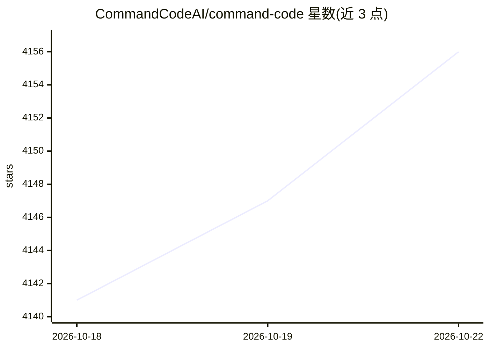

# CommandCodeAI/command-code

⭐ 4,163 · 推送 2026-10-20 · [GitHub](https://github.com/CommandCodeAI/command-code) · [官网](https://commandcode.ai) · 组织维护

**面向开源模型的 CLI 编程 agent，学习用户编码品味**

Command Code 是一个 npm 安装的命令行编程 agent，面向使用开源模型的开发者：在终端中构建全栈项目、开发功能、修 bug、写测试与重构。其核心机制是 taste-1 模型：将用户对生成的每次接受、拒绝与编辑作为信号，持续学习用户的编码品味，并可通过 npx taste push/pull 在团队间共享品味配置。提供交互模式（斜杠命令、Bash 模式、文件路径补全）、工作流文档与 Discord 社区。

## 筛选速览

| 维度 | 判定 | 备注 |
|---|---|---|
| AI 角色 | `ai-native` | 本体是模型或模型工具 |
| 许可风险 | `none` | — |
| 部署形态 | `library` | 以包/库形式分发 |
| 模型依赖 | — | README 未给出锁定关系 |
| 硬件要求 | — | 无带数字的原话,不猜 |
| 安装摩擦 | `low` | 无编译、无系统依赖或容器化 |
| 成熟度 | — | 结构信号不足 |

## 能力要点

- 从接受/拒绝/编辑信号中持续学习用户编码品味的 taste-1 模型
- 通过 npx taste push/pull 在团队间共享品味配置
- 交互模式：`/` 命令菜单、`!` Bash 模式、`@` 文件路径补全
- npm 全局安装，`cmd` 命令在项目中启动会话

## 适用场景

- 在终端里让 agent 完成功能开发、修 bug、写测试与重构
- 让 agent 逐步学习并匹配自己的编码风格偏好
- 团队内共享编码品味配置以统一代码风格

## 场景标签

`编码 Agent` · 领域:编码与开发

## 证据(README 行号)

> L5:  The first frontier coding agent that both builds software and continuously learns your coding taste. Ships full-sta
> L25: - **Continuously Learning** - every accept, reject, and edit becomes a signal that shapes your taste profile.

## 星数曲线

2026-10-18 4,141 → 2026-10-22 4,156（+15）

---
*卡片 v1 · prompt 1.4 · 生成 2026-10-20 · 置信度 mid · 依据 README sha `b9774a8431ac` · [字段定义](../../DATASET.md)*
