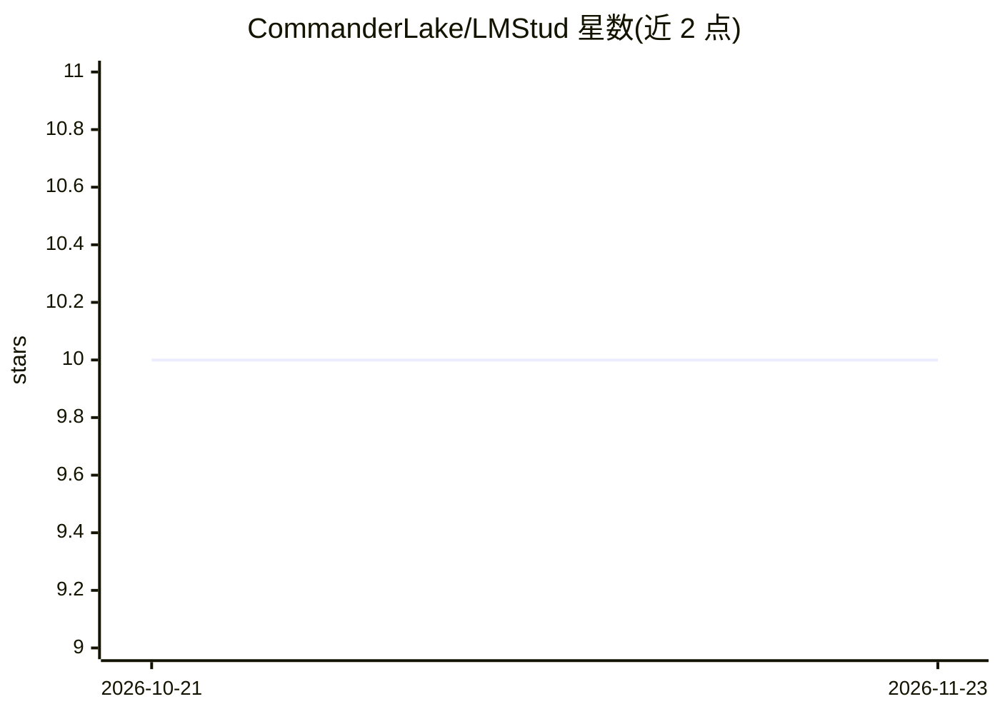

# CommanderLake/LMStud

⭐ 10 · C# · 推送 2026-11-08 · [GitHub](https://github.com/CommanderLake/LMStud) · 个人维护

**Windows 桌面客户端：用 llama.cpp 本地运行和编排 GGUF 大模型**

基于 WinForms 的本地大模型桌面程序，通过 llama.cpp 加载 GGUF 模型对话，支持视觉模型与 whisper.cpp 语音输入输出。R48 引入槽位系统：本地、API、MCP 槽位可标记为聊天、辩证、工具或 API 服务器用途，多模型可并行生成并共享本地权重。内置工具（搜索、文件读写、命令提示符）、API 客户端与服务器，可解析多种响应格式。需自行从源码构建（Visual Studio、vcpkg、llama.cpp），支持 CUDA 10.2 与 CUDA 12.8 构建。

## 筛选速览

| 维度 | 判定 | 备注 |
|---|---|---|
| AI 角色 | `ai-native` | 本体是模型或模型工具 |
| 许可风险 | `none` | — |
| 部署形态 | `None` |  |
| 模型依赖 | local-ok | 支持本地模型 |
| 硬件要求 | — | 无带数字的原话,不猜 |
| 安装摩擦 | `medium` | 含编译或系统依赖之一 |
| 成熟度 | — | 结构信号不足 |

## 能力要点

- 槽位系统：本地/API/MCP 槽位可指定聊天、辩证、工具、API 服务器用途
- 多模型同时加载并行生成，相同模型文件共享权重以降低内存占用
- 内置工具集：Google 搜索、网页抓取、文件读写/补丁、命令提示符
- API 客户端解析 OpenAI/Anthropic/Ollama/Gemini 等响应格式，并自带 API 服务器

## 适用场景

- 在 Windows 上加载本地 GGUF 模型进行对话和视觉理解
- 让多个本地模型互相讨论或把一个模型作为另一模型的工具
- 通过 whisper.cpp 用语音与大模型交互
- 本地搭建 API 服务器，把请求路由到配置好的模型槽位

## 场景标签

`聊天机器人` `推理引擎` `语音 Agent` · 领域:对话与助手

## 证据(README 行号)

> L9: LM Stud is a Windows desktop program for running and orchestrating local language models without wrapping the whole 
> L32: |**Local chat**|Load GGUF models through `llama.cpp`, including vision models, chat, edit messages, regenerate from

## 星数曲线

2026-10-21 10 → 2026-11-23 10（+0）

---
*卡片 v1 · prompt 1.4 · 生成 2026-11-20 · 置信度 high · 依据 README sha `5e56a58733cd` · [字段定义](../../DATASET.md)*
