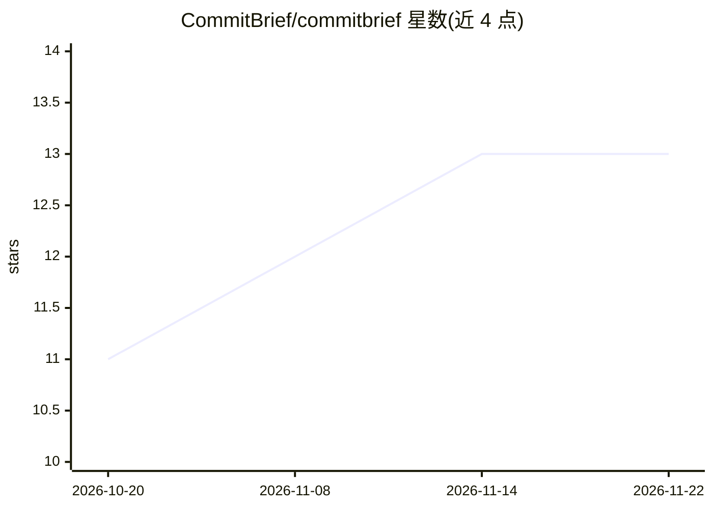

# CommitBrief/commitbrief

⭐ 13 · Go · GPL-3.0 · 推送 2026-11-21 · [GitHub](https://github.com/CommitBrief/commitbrief) · [官网](https://commitbrief.com) · 组织维护

**本地 LLM 对 git diff 做 code review 的终端 CLI**

用 Go 编写的命令行工具，对暂存区变更、工作树与 HEAD 差异、任意 diff 区间或 GitHub PR 三点区间发起 LLM 审查，结果可输出为终端彩色 markdown、文件 markdown 或严格 JSON。支持缓存未变更 diff、通过仓库内 COMMITBRIEF.md 定制审查规则、声明式 policy.yml 策略门禁、凭据泄漏审计，并提供 MCP server 供 AI agent 自审。默认 local-first：diff 仅发送给所选 provider，或经 Ollama 完全留在本机。

## 筛选速览

| 维度 | 判定 | 备注 |
|---|---|---|
| AI 角色 | `ai-native` | 本体是模型或模型工具 |
| 许可风险 | `viral` | GPL-3.0 |
| 部署形态 | `library` | 以包/库形式分发 |
| 模型依赖 | local-ok | 支持本地模型 |
| 硬件要求 | — | 无带数字的原话,不猜 |
| 安装摩擦 | `low` | 无编译、无系统依赖或容器化 |
| 成熟度 | — | 结构信号不足 |

## 能力要点

- 支持暂存变更、指定文件、单 commit、三点区间与 GitHub PR 多种审查范围
- 多 provider 接入：anthropic/openai/gemini/ollama/deepseek/mistral/cohere 及任意 OpenAI 兼容端点，或复用本地 claude-cli/gemini-cli/codex-cli 订阅
- 缓存未变更 diff，本地 COMMITBRIEF.md 规则与 policy.yml 策略门禁
- 提供 MCP server 供 AI agent 自主调用审查

## 适用场景

- 提交代码前在终端对暂存变更做快速 LLM 审查
- 审查 GitHub PR 并在 CI 中按发现结果做门禁
- 希望 diff 不离开本机，用 Ollama 本地模型离线审查

## 场景标签

`代码审查` · 领域:编码与开发

## 证据(README 行号)

> L3: Local LLM code review CLI for git diffs — review staged/unstaged changes, any git diff range, or a GitHub PR, right 
> L60: Shipped providers: `anthropic`, `openai`, `gemini`, `ollama` (native
> L74: - MCP server — let an AI agent self-review

## 星数曲线

2026-10-20 11 → 2026-11-22 13（+2）

---
*卡片 v1 · prompt 1.4 · 生成 2026-11-18 · 置信度 high · 依据 README sha `10dbe0429049` · [字段定义](../../DATASET.md)*
