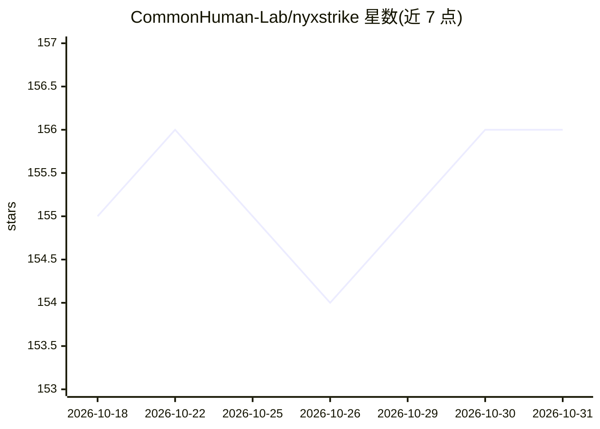

# CommonHuman-Lab/nyxstrike

⭐ 156 · Python · NOASSERTION · 推送 2026-10-30 · [GitHub](https://github.com/CommonHuman-Lab/nyxstrike) · [官网](https://discord.gg/aC8Q2xJFgp) · 组织维护

**把 LLM agent 接入 200+ 攻击工具的渗透测试编排引擎**

通过 MCP 协议把 LLM agent（Claude Desktop、Cursor、OpenCode、VS Code Copilot 等）接入 200+ 进攻性安全工具，由 AI 决策引擎编排完整攻击链（侦察→枚举→利用→报告），工具可在扫描中动态排序重评分。内置本地工作台（40+ 加解密/编码/分析操作）、实时仪表盘（localhost:8888）与防篡改证据链（每次工具运行哈希链化）。源码安装，脚本启动服务并可选安装外部工具；要求仅在授权与隔离环境中使用，AGPLv3 许可并另提供商业授权联系渠道。

## 筛选速览

| 维度 | 判定 | 备注 |
|---|---|---|
| AI 角色 | `ai-ecosystem` | LLM/agent 周边工具 |
| 许可风险 | `none` | NOASSERTION |
| 部署形态 | `None` |  |
| 模型依赖 | — | README 未给出锁定关系 |
| 硬件要求 | — | 无带数字的原话,不猜 |
| 安装摩擦 | `low` | 无编译、无系统依赖或容器化 |
| 成熟度 | — | 结构信号不足 |

## 能力要点

- MCP 协议接入任意兼容 AI 客户端
- AI 决策引擎编排 200+ 工具、50+ 类别的攻击链
- 每次工具运行哈希链化，形成防篡改证据链
- 本地载荷与数据工作台，40+ 加解密/编码/分析操作无需目标

## 适用场景

- 授权渗透测试中让 AI agent 自动串联侦察到利用的攻击链
- 红队演练与 CTF 中通过对话客户端驱动安全工具
- 生成可验证、防篡改的测试证据用于报告

## 场景标签

`网络安全` · 领域:学习与行业

## 证据(README 行号)

> L9: NyxStrike connects LLM agents to real offensive security tools and executes full attack chains — from recon to explo
> L34: ## 🔌 AI Agent Integrations (MCP)
> L36: Connect NyxStrike to any MCP-compatible AI client — OpenCode, Cursor, Claude Desktop, VS Code Copilot, Roo Code, an

## 星数曲线

2026-10-18 155 → 2026-10-31 156（+1）

---
*卡片 v1 · prompt 1.4 · 生成 2026-10-22 · 置信度 high · 依据 README sha `eac2f5dda65f` · [字段定义](../../DATASET.md)*
