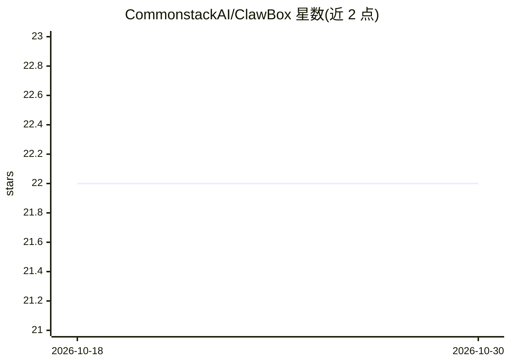

# CommonstackAI/ClawBox

⭐ 22 · TypeScript · MIT · 推送 2026-04-14 · [GitHub](https://github.com/CommonstackAI/ClawBox) · 组织维护 · 中文 README

**OpenClaw 桌面客户端：引导式安装与统一管理面板**

ClawBox 是面向 OpenClaw Gateway 的开源桌面客户端，将 Tauri v2 外壳、React 18 前端与 Bun/Hono 后端打包为单一桌面应用。首次启动提供设置向导：可由应用托管便携 Node.js 运行时并自动安装 OpenClaw，或接入用户已有的 System Install/远程 Gateway。功能覆盖会话聊天、Soul 文件编辑、channels、cron、插件与技能管理。上游模型提供方支持 CommonStack 默认路径及 OpenAI/Anthropic 兼容自定义端点；兼容基线为 OpenClaw ≥2026.3.12。macOS 发布包未做 Apple 公证，需手动移除隔离属性或从源码构建。

## 筛选速览

| 维度 | 判定 | 备注 |
|---|---|---|
| AI 角色 | `ai-ecosystem` | LLM/agent 周边工具 |
| 许可风险 | `permissive` | MIT |
| 部署形态 | `desktop` | 安装包/桌面程序 |
| 模型依赖 | — | README 未给出锁定关系 |
| 硬件要求 | — | 无带数字的原话,不猜 |
| 安装摩擦 | `low` | 无编译、无系统依赖或容器化 |
| 成熟度 | — | 结构信号不足 |

## 能力要点

- 设置向导可自动准备便携 Node.js 运行时并安装 OpenClaw
- 统一面板管理聊天、会话、channels、cron、插件与技能
- 支持 OpenAI 兼容或 Anthropic 兼容自定义上游提供方
- macOS/Windows 提供 GitHub Releases 安装包，Linux 仅源码构建

## 适用场景

- 为 OpenClaw agent 提供带引导式安装的桌面入口
- 在统一界面里管理会话、频道、定时任务与技能
- 连接已部署的 OpenClaw Gateway 并配置自定义模型提供方

## 场景标签

`AI 助手` · 领域:对话与助手

## 证据(README 行号)

> L3:  ClawBox is a desktop client for the OpenClaw Gateway. It packages a Tauri shell, a React frontend, and a Bun/Hono b
> L30: - `Portable (Built-in)`: recommended for most users. ClawBox prepares an app-managed portable Node.js runtime and i
> L61: - start chats and manage sessions

## 星数曲线

2026-10-18 22 → 2026-10-30 22（+0）

---
*卡片 v1 · prompt 1.4 · 生成 2026-10-28 · 置信度 high · 依据 README sha `318c7de5d39f` · [字段定义](../../DATASET.md)*
