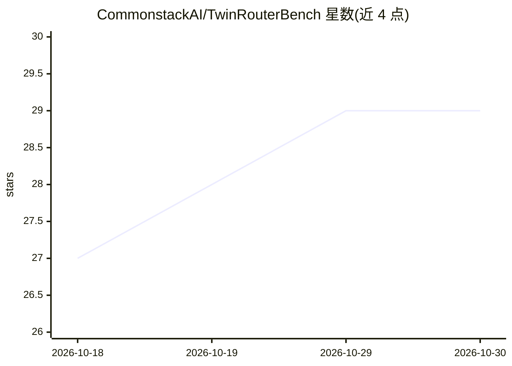

# CommonstackAI/TwinRouterBench

⭐ 29 · Python · Apache-2.0 · 推送 2026-10-28 · [GitHub](https://github.com/CommonstackAI/TwinRouterBench) · [官网](https://commonstackai.github.io/TwinRouterBench/) · 组织维护

**逐步 LLM 路由基准：静态标签+动态 SWE-bench 评测与排行榜**

面向 agent 每步模型选择的基准工具：静态轨道提供 970 条执行验证的标签（520 条轨迹、5 类工作负载）与离线路由评分；动态轨道在锁定的 100 个 SWE-bench 用例（18 Astropy、82 Django）上评测端到端任务成功率与实际 API 花费，并提供公开排行榜。以 Python 包+CLI 形式发布（pip 安装），动态轨道需 Docker、网络与 API key，静态轨道可离线运行；包含 OpenAI 兼容网关配置与 semantic-router KNN 路由适配。面向做模型路由与成本优化的研究人员和开发者。

## 筛选速览

| 维度 | 判定 | 备注 |
|---|---|---|
| AI 角色 | `ai-ecosystem` | LLM/agent 周边工具 |
| 许可风险 | `permissive` | Apache-2.0 |
| 部署形态 | `self-host` | docker 或自建部署 |
| 模型依赖 | locked-api |  |
| 硬件要求 | — | 无带数字的原话,不猜 |
| 安装摩擦 | `low` | 无编译、无系统依赖或容器化 |
| 成熟度 | — | 结构信号不足 |

## 能力要点

- 静态轨道 970 条执行验证标签与确定性离线评分
- 动态轨道锁定 100 个 SWE-bench 用例的实机路由评测
- 公开排行榜与提交规则，输出 pass_rate 与 cost_savings 等指标
- CLI 覆盖 data/static/dynamic/swe 四个子命令面

## 适用场景

- 评估模型路由器在 agent 多步调用下的成本节省与成功率
- 在 SWE-bench 锁定用例上复现排行榜结果并提交路由器
- 离线复现数据构建流水线（无需 API key）

## 场景标签

`模型评测` · 领域:评测与运维

## 证据(README 行号)

> L5: **A two-track benchmark for choosing the cheapest sufficient LLM at every agent step.**
> L25: conversation history. TwinRouterBench evaluates the decision the router actually
> L30: |**Static**|Cheapest-sufficient tier at each routed step, verified through downgrade search and mixed-model executi
> L31: |**Dynamic**|End-to-end task success and realized API spend while routing every live agent call.|**Leaderboard: the

## 星数曲线

2026-10-18 27 → 2026-10-30 29（+2）

---
*卡片 v1 · prompt 1.4 · 生成 2026-10-26 · 置信度 mid · 依据 README sha `b3b136beb3f0` · [字段定义](../../DATASET.md)*
