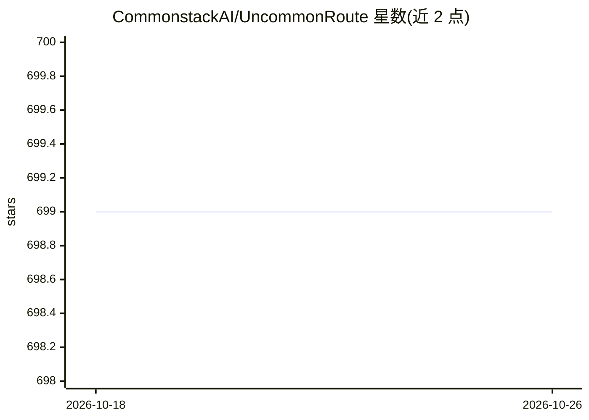

# CommonstackAI/UncommonRoute

⭐ 699 · Python · MIT · 推送 2026-06-26 · [GitHub](https://github.com/CommonstackAI/UncommonRoute) · 组织维护 · 中文 README

**本地 LLM 路由代理：按请求难度自动选模型以降低 API 费用**

运行在本地的 OpenAI/Anthropic 兼容代理，插在 Claude Code、Cursor、Codex 或 OpenAI SDK 之前，对每个请求按任务难度分类（simple/medium/complex）并路由到对应档位的模型。分类由元数据、BGE 嵌入与结构信号三个本地信号投票决定；路由决策可在本地 Dashboard 中查看与调整，用户反馈可训练本地 overlay 且不修改基础模型。支持 BYOK 多提供商接入、花费上限与本地隐私存储。在 100 例 SWE-bench Verified 留出集上报告了解决任务数持平、API 花费下降 53% 的结果。

## 筛选速览

| 维度 | 判定 | 备注 |
|---|---|---|
| AI 角色 | `ai-ecosystem` | LLM/agent 周边工具 |
| 许可风险 | `permissive` | MIT |
| 部署形态 | `library` | 以包/库形式分发 |
| 模型依赖 | locked-api |  |
| 硬件要求 | — | 无带数字的原话,不猜 |
| 安装摩擦 | `low` | 无编译、无系统依赖或容器化 |
| 成熟度 | — | 结构信号不足 |

## 能力要点

- 三本地信号（元数据/BGE 嵌入/结构）投票做请求级难度分类
- Dashboard 记录并解释每次路由决策，反馈可训练可回滚的本地 overlay
- 支持 Claude Code、Cursor、Codex、OpenAI SDK 免改代码接入
- 按请求/小时/日设置 API 花费上限

## 适用场景

- 日常使用编码 agent 时降低前沿模型 API 支出
- 在不经过额外云端路由服务的前提下做请求级模型选择
- 查看并调整每笔请求的路由决策与花费

## 场景标签

`模型网关` · 领域:Agent 开发

## 证据(README 行号)

> L7: UncommonRoute plugs into Claude Code, Cursor, Codex, or the OpenAI SDK. It runs locally and routes each request to t
> L101: |Claude Code|`export ANTHROPIC_BASE_URL="http://localhost:8403"`|Uses the Anthropic-compatible proxy|
> L137: Each request runs through three local signals. The router first classifies task complexity, then picks the best mo

## 星数曲线

2026-10-18 699 → 2026-10-26 699（+0）

---
*卡片 v1 · prompt 1.4 · 生成 2026-10-21 · 置信度 high · 依据 README sha `4f6634002b86` · [字段定义](../../DATASET.md)*
