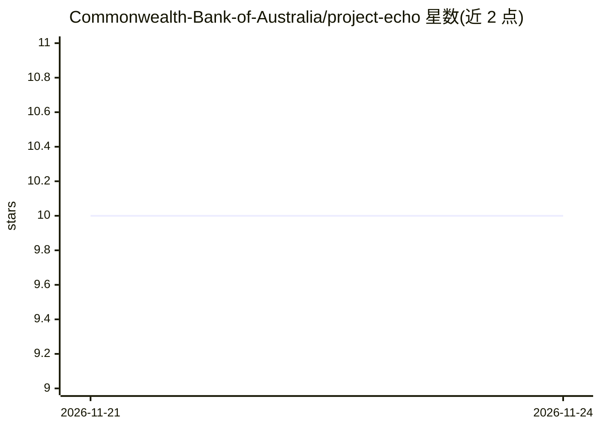

# Commonwealth-Bank-of-Australia/project-echo

⭐ 10 · Python · MIT · 推送 2026-07-31 · [GitHub](https://github.com/Commonwealth-Bank-of-Australia/project-echo) · 组织维护

**将视频档案转录并标注为可搜索知识库的流水线**

澳大利亚联邦银行档案团队发布的视频转录与标注流水线（AI Labs 项目）：对每个上传文件依次执行 Whisper 兼容端点的长音频分块转录、ffmpeg 场景检测与视觉模型生成关键帧描述、可选 LLM 叙事总结，结果写入 SQLite/DynamoDB 或 S3/本地存储。面向有大量音视频档案需编目检索的机构。存储与数据库后端独立可配置，全部 AI 端点走 OpenAI 兼容接口，模型名与端点均可替换。

## 筛选速览

| 维度 | 判定 | 备注 |
|---|---|---|
| AI 角色 | `ai-native` | 本体是模型或模型工具 |
| 许可风险 | `permissive` | MIT |
| 部署形态 | `None` |  |
| 模型依赖 | local-ok | 支持本地模型 |
| 硬件要求 | — | 无带数字的原话,不猜 |
| 安装摩擦 | `medium` | 含编译或系统依赖之一 |
| 成熟度 | — | 结构信号不足 |

## 能力要点

- Whisper 兼容端点长音频自动分块转录（含重叠与分块上限）
- ffmpeg 场景检测 + 可选聚类感知两遍式关键帧提取
- 全部 AI 设置指向 OpenAI 兼容端点，支持自托管 vLLM
- 存储/数据库可独立配置：本地/S3、SQLite/DynamoDB

## 适用场景

- 将磁带数字化的档案音视频批量转录编目
- 为历史影像生成场景描述与叙事摘要以便检索
- 自托管模型端点处理涉密或本地化档案

## 场景标签

`语音识别` `图像视频处理` `知识库管理` · 领域:知识与检索

## 证据(README 行号)

> L8: Project ECHO is an AI Labs project that turns raw archival footage into a searchable knowledge base. It does this by
> L9: - Transcribing the audio using speech-to-text models, turning decades of spoken content into text.
> L10: - Extracting representative keyframes from the footage and using multi-modal AI models (VLMs) to generate scene des

## 星数曲线

2026-11-21 10 → 2026-11-24 10（+0）

---
*卡片 v1 · prompt 1.4 · 生成 2026-11-21 · 置信度 high · 依据 README sha `75fd7280890a` · [字段定义](../../DATASET.md)*
