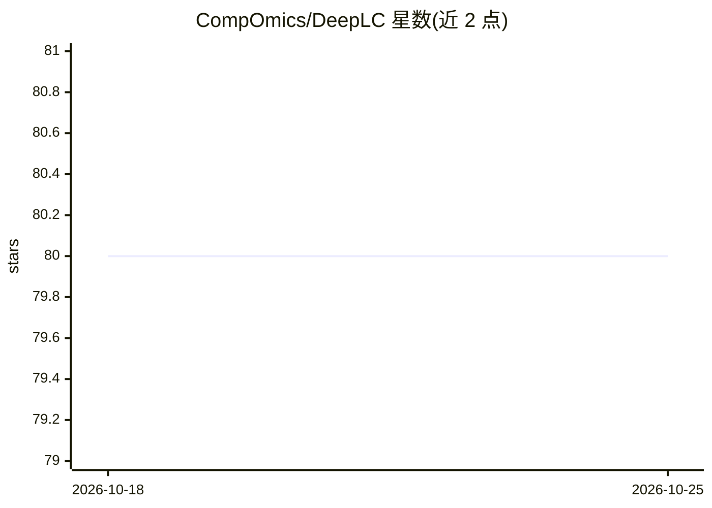

# CompOmics/DeepLC

⭐ 80 · Python · Apache-2.0 · 推送 2026-10-24 · [GitHub](https://github.com/CompOmics/DeepLC) · [官网](https://iomics.ugent.be/deeplc) · 组织维护

**蛋白质组学工具：预测携带任意修饰肽段的液相保留时间**

面向蛋白质组学研究者的深度学习保留时间预测器：基于原子组成特征，可预测携带未知修饰的肽段保留时间；v4 起内置覆盖 6,543 种 LC 设置的多任务预训练模型，开箱即用，并支持用少量已鉴定 PSM 参考集做校准或迁移学习微调。提供托管网页应用（iomics.ugent.be/deeplc）、Windows 一键安装包的本地图形界面、pip 安装的 CLI 与 Python API（基于 psm_utils 读取输入）。复现论文需用 v3.1.13，常规使用建议最新稳定版。

## 筛选速览

| 维度 | 判定 | 备注 |
|---|---|---|
| AI 角色 | `ai-native` | 本体是模型或模型工具 |
| 许可风险 | `permissive` | Apache-2.0 |
| 部署形态 | `desktop` | 安装包/桌面程序 |
| 模型依赖 | — | README 未给出锁定关系 |
| 硬件要求 | — | 无带数字的原话,不猜 |
| 安装摩擦 | `low` | 无编译、无系统依赖或容器化 |
| 成熟度 | — | 结构信号不足 |

## 能力要点

- 预测携带任意（含未见）修饰肽段的保留时间
- v4 多任务预训练模型覆盖 6,543 种 LC 设置
- 支持用小规模 PSM 参考集校准/迁移学习微调
- 提供网页应用、本地 GUI、CLI 与 Python API 多种使用方式

## 适用场景

- 蛋白质组学实验中预测肽段保留时间
- 为 MS²Rescore 等工具提供保留时间重打分特征
- 用少量本地数据校准以适配特定 LC 设置

## 场景标签

`科研工具` · 领域:学习与行业

## 证据(README 行号)

> L11: DeepLC predicts retention times for peptides carrying any modification. It does this by leveraging
> L12: a deep learning model based on atomic composition features. Starting with v4, DeepLC comes with a
> L66: calibrated_rt = predict_and_calibrate(psm_list)

## 星数曲线

2026-10-18 80 → 2026-10-25 80（+0）

---
*卡片 v1 · prompt 1.4 · 生成 2026-10-24 · 置信度 high · 依据 README sha `bce061a1f415` · [字段定义](../../DATASET.md)*
