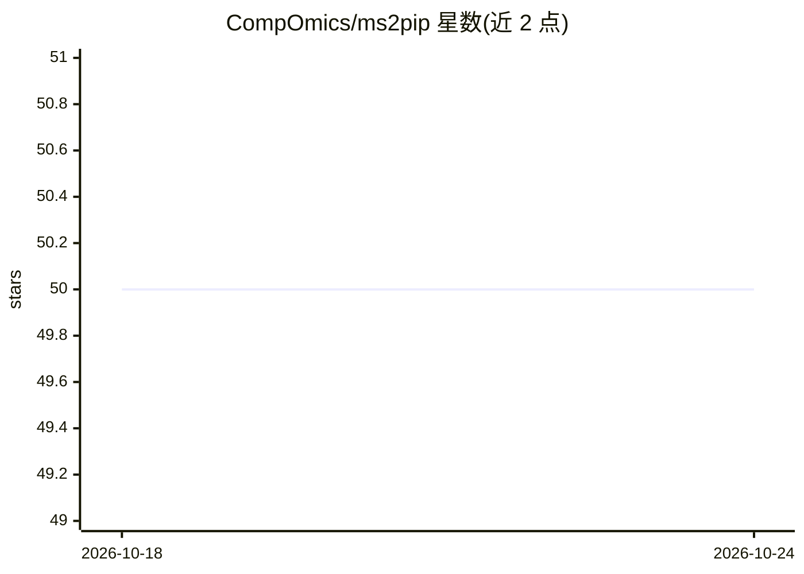

# CompOmics/ms2pip

⭐ 50 · HTML · Apache-2.0 · 推送 2026-07-13 · [GitHub](https://github.com/CompOmics/ms2pip) · [官网](https://ms2pip.readthedocs.io) · 组织维护

**从肽序列预测 MS2 质谱峰强度的蛋白质组学工具**

MS²PIP 基于 XGBoost 机器学习算法（Python 编写，Rust 辅助函数），从肽序列预测 MS2 峰强度，生成与观测谱相近的肽碎裂谱预测。提供 predict-single/predict-batch/predict-library、correlate、get-training-data、annotate-spectra 等命令，附带覆盖多种碎裂方法、仪器与标记技术的预训练模型，支持多种 PSM 输入与谱输出格式。面向蛋白质组学科研用户，可通过 PyPI 安装或使用其 Web 服务器与 RESTful API。

## 筛选速览

| 维度 | 判定 | 备注 |
|---|---|---|
| AI 角色 | `ai-native` | 本体是模型或模型工具 |
| 许可风险 | `permissive` | Apache-2.0 |
| 部署形态 | `library` | 以包/库形式分发 |
| 模型依赖 | — | README 未给出锁定关系 |
| 硬件要求 | — | 无带数字的原话,不猜 |
| 安装摩擦 | `low` | 无编译、无系统依赖或容器化 |
| 成熟度 | — | 结构信号不足 |

## 能力要点

- 从肽序列预测 MS2 峰强度（XGBoost 模型）
- predict-library 可从蛋白 FASTA 文件生成谱库
- 预训练模型覆盖多种碎裂方法、仪器与标记技术
- 支持多种 PSM 输入格式与谱输出格式

## 适用场景

- 验证肽段鉴定结果
- 生成全蛋白质组谱库
- 为靶向蛋白质组学筛选区分性 transitions

## 场景标签

`科研工具` · 领域:学习与行业

## 证据(README 行号)

> L29: MS²PIP is a tool to predict MS2 peak intensities from peptide sequences. The result is a predicted
> L33: `XGBoost <https://xgboost.readthedocs.io/en/stable/>`_ machine learning algorithm and is written in

## 星数曲线

2026-10-18 50 → 2026-10-24 50（+0）

---
*卡片 v1 · prompt 1.4 · 生成 2026-10-24 · 置信度 high · 依据 README sha `947307b9731d` · [字段定义](../../DATASET.md)*
