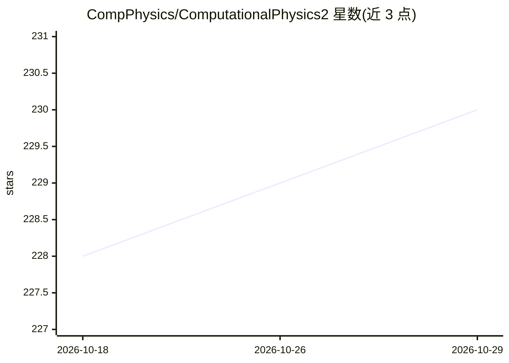

# CompPhysics/ComputationalPhysics2

⭐ 230 · CC0-1.0 · 推送 2026-05-07 · [GitHub](https://github.com/CompPhysics/ComputationalPhysics2) · [官网](http://compphysics.github.io/ComputationalPhysics2/doc/web/course) · 组织维护

**奥斯陆大学计算物理 II 课程资料库：多体量子力学讲义与项目**

University of Oslo 的 FYS4411/FYS9411 计算物理研究生课程仓库，收录讲义幻灯片、程序、练习与项目，主题为多粒子相互作用体系的量子力学计算方法：Hartree-Fock、密度泛函、耦合簇、变分与扩散蒙特卡罗等，并涉及高性能并行化；机器学习与量子计算为可选内容。课程以两个计分项目代替考试，仓库本身不提供可安装的软件产品，仅列出 Python/C++ 工具链建议。

## 筛选速览

| 维度 | 判定 | 备注 |
|---|---|---|
| AI 角色 | `ai-knowledge` | 知识聚合/清单类 |
| 许可风险 | `viral` | CC0-1.0 |
| 部署形态 | `library` | 以包/库形式分发 |
| 模型依赖 | — | README 未给出锁定关系 |
| 硬件要求 | — | 无带数字的原话,不猜 |
| 安装摩擦 | `low` | 无编译、无系统依赖或容器化 |
| 成熟度 | — | 结构信号不足 |

## 能力要点

- 覆盖 Hartree-Fock、DFT、耦合簇、量子蒙特卡罗等多体方法的教学项目
- 含讲义幻灯片、练习、程序与两个计分项目
- 推荐 Python/C++ 科学计算与机器学习工具链（numpy、scikit-learn、TensorFlow 等）

## 适用场景

- 修读计算物理课程并完成量化项目
- 自学多体量子力学数值方法与配套讲义
- 查找量子蒙特卡罗等方法的课程代码与练习

## 场景标签

`教程课程` · 领域:学习与行业

## 证据(README 行号)

> L5: This repository contain lecture slides, programs, exercises and
> L27: orientation. Furthermore, Machine Learning and quantum

## 星数曲线

2026-10-18 228 → 2026-10-29 230（+2）

---
*卡片 v1 · prompt 1.4 · 生成 2026-10-22 · 置信度 mid · 依据 README sha `0860390412da` · [字段定义](../../DATASET.md)*
