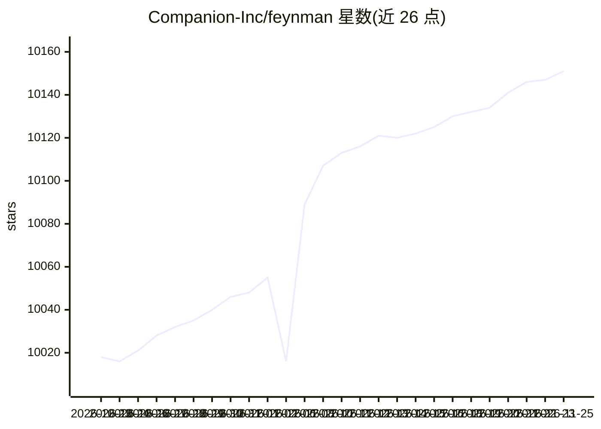

# Companion-Inc/feynman

⭐ 10,151 · TypeScript · MIT · 推送 2026-11-23 · [GitHub](https://github.com/Companion-Inc/feynman) · [官网](https://feynman.is) · 组织维护

**面向研究者的开源 AI 科研 agent CLI**

Feynman 是一个 CLI 形式的 AI 研究代理：提供 deepresearch、文献综述、论文评审、论文代码审计、复现计划、ML 训练配方、草稿撰写等工作流命令，输出保存到 outputs/ 与 papers/ 目录，部分工作流附带 provenance 来源记录文件。检索源覆盖 alphaXiv、Semantic Scholar、OpenAlex、arXiv、PubMed 等学术数据库及网络与 Hugging Face，可读取本地 PDF；基于 Pi 运行时内置 researcher/verifier/reviewer/writer 四个 agent，可通过 MCP 添加自有工具。遥测可开关。

## 筛选速览

| 维度 | 判定 | 备注 |
|---|---|---|
| AI 角色 | `ai-native` | 本体是模型或模型工具 |
| 许可风险 | `permissive` | MIT |
| 部署形态 | `library` | 以包/库形式分发 |
| 模型依赖 | — | README 未给出锁定关系 |
| 硬件要求 | — | 无带数字的原话,不猜 |
| 安装摩擦 | `low` | 无编译、无系统依赖或容器化 |
| 成熟度 | — | 结构信号不足 |

## 能力要点

- 10 种科研工作流命令（/deepresearch、/lit、/audit、/replicate 等）
- 检索 alphaXiv、Semantic Scholar、arXiv、PubMed 等 11 类来源并生成 provenance 文件
- 运行于 Pi，含 researcher/verifier/reviewer/writer 四个 agent
- 支持通过 feynman mcp add 接入 Zotero 等自有工具

## 适用场景

- 对某研究主题做带引用核查的深度调研
- 梳理某课题的共识、分歧与开放问题
- 审阅论文草稿并生成修改计划
- 核对论文声明与其公开代码的一致性

## 场景标签

`科研工具` · 领域:学习与行业

## 证据(README 行号)

> L5:  The open source AI research agent.
> L45: |`/deepresearch <topic>`|Planned investigation with parallel researchers and citation checks|

## 星数曲线

2026-10-23 10,018 → 2026-11-25 10,151（+133）

---
*卡片 v1 · prompt 1.4 · 生成 2026-11-22 · 置信度 high · 依据 README sha `fd4fa325da3a` · [字段定义](../../DATASET.md)*
