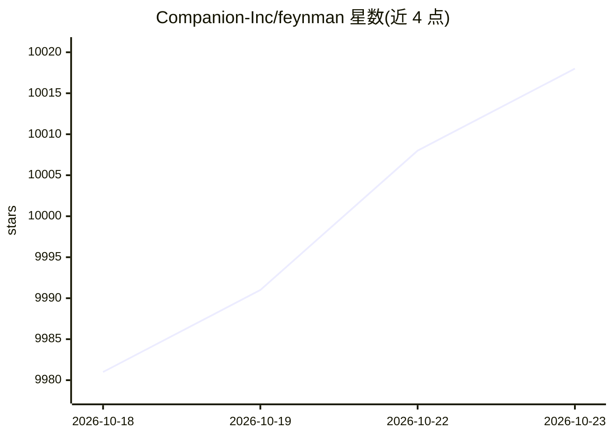

# Companion-Inc/feynman

⭐ 10,018 · TypeScript · MIT · 推送 2026-10-22 · [GitHub](https://github.com/Companion-Inc/feynman) · [官网](https://feynman.is) · 组织维护

**开源 AI 科研 agent CLI：文献综述、深度研究与论文审查**

命令行形态的 AI 研究 agent：通过 /deepresearch、/lit、/review、/audit、/replicate 等 10 种工作流执行计划式调研、文献综述、论文批评、声明-代码审计、复现计划与草稿生成，结果写入 outputs/ 与 papers/，部分工作流附带来源溯源文件。检索源覆盖 arXiv、Semantic Scholar、OpenAlex、PubMed、bioRxiv、Hugging Face 等十余种并可读取本地 PDF。安装提供 curl/PowerShell 脚本与 npm 包，运行前需 feynman setup 登录模型提供商，含 PostHog 遥测（可关闭）。

## 筛选速览

| 维度 | 判定 | 备注 |
|---|---|---|
| AI 角色 | `ai-native` | 本体是模型或模型工具 |
| 许可风险 | `permissive` | MIT |
| 部署形态 | `library` | 以包/库形式分发 |
| 模型依赖 | — | README 未给出锁定关系 |
| 硬件要求 | — | 无带数字的原话,不猜 |
| 安装摩擦 | `low` | 无编译、无系统依赖或容器化 |
| 成熟度 | — | 结构信号不足 |

## 能力要点

- 10 种研究工作流（deepresearch/lit/review/audit/replicate 等）
- 检索 alphaXiv、Semantic Scholar、OpenAlex、arXiv、PubMed 等 10+ 来源并读本地 PDF
- 四 agent 架构：researcher、verifier、reviewer、writer
- /lit、/deepresearch、/recipe 输出来源溯源文件

## 适用场景

- 我对一个新课题做带引用核查的深度调研
- 我让 AI 批评我的论文草稿并给出修改计划
- 我让 AI 对比论文声明与其公开代码是否一致

## 场景标签

`科研工具` · 领域:学习与行业

## 证据(README 行号)

> L5:  The open source AI research agent.
> L40: feynman deepresearch "mechanistic interpretability"
> L45: |`/deepresearch <topic>`|Planned investigation with parallel researchers and citation checks|

## 星数曲线

2026-10-18 9,981 → 2026-10-23 10,018（+37）

---
*卡片 v1 · prompt 1.4 · 生成 2026-10-20 · 置信度 high · 依据 README sha `ba055209bda9` · [字段定义](../../DATASET.md)*
