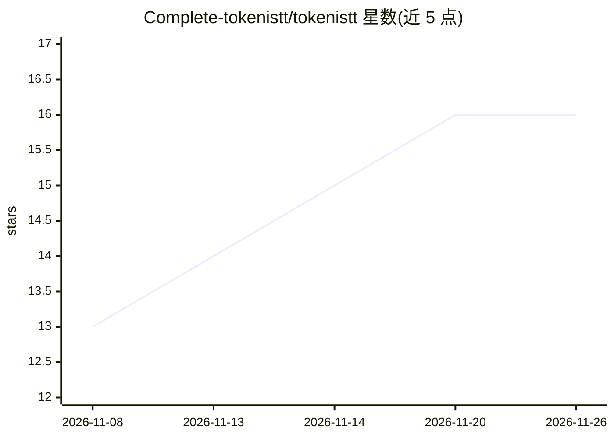

# Complete-tokenistt/tokenistt

⭐ 16 · TypeScript · Apache-2.0 · 推送 2026-11-23 · [GitHub](https://github.com/Complete-tokenistt/tokenistt) · [官网](tokenistt.com) · 组织维护

**自托管 AI 成本治理网关：追踪 LLM 支出、预算与策略审计**

自托管的 OpenAI 兼容网关，部署在应用与各 AI 提供商之间，提供每请求计价（含缓存与推理 token）、组织/团队/项目/密钥多级预算（alert_only/auto_throttle/hard_cap）、策略治理（allow/block/force_model/require_approval）、成本感知路由与故障转移、BYOK 加密密钥存储、按团队/项目/工单的支出归因、GitHub/Jira/Slack 等连接器及只追加审计日志。面向成长期团队，配套 Python/TS SDK、仪表盘、CLI、VS Code 扩展与 MCP server。三人小队、pre-traction 早期阶段，核心流程已端到端测试。

## 筛选速览

| 维度 | 判定 | 备注 |
|---|---|---|
| AI 角色 | `ai-ecosystem` | LLM/agent 周边工具 |
| 许可风险 | `permissive` | Apache-2.0 |
| 部署形态 | `self-host` | docker 或自建部署 |
| 模型依赖 | local-ok | 支持本地模型 |
| 硬件要求 | — | 无带数字的原话,不猜 |
| 安装摩擦 | `low` | 无编译、无系统依赖或容器化 |
| 成熟度 | `idea` | |

## 能力要点

- OpenAI 兼容网关：每请求计价、多级预算与三种预算模式
- 策略治理含审批流与 force_model，审计日志只追加（禁 UPDATE/DELETE）
- 支持 OpenAI/Anthropic/Azure/Bedrock/Groq/Together/Gemini/Ollama 及离线 mock 提供商
- 配套 SDK（含 cache 零成本重放）、CLI（本地代码知识图谱与 MCP server）与 VS Code 扩展

## 适用场景

- 我把所有 AI 流量收进一个网关，按团队和项目归因成本
- 我需要预算硬顶与策略审批来治理团队的 LLM 使用
- 我想在本地用 mock 提供商零成本跑通整套流程

## 场景标签

`模型网关` `LLM 可观测性` · 领域:Agent 开发

## 证据(README 行号)

> L7: One OpenAI-compatible gateway in front of every AI provider you use — spend tracking, budgets, policies,
> L168: |💸 **Cost visibility**|Every request is priced (input, output, cache, reasoning tokens) from a versioned catalog. 
> L201:     App["Your app / editor / agent (OpenAI SDK, Continue, Cline, Tokenistt SDK)"] -->|OpenAI-compatible API| G

## 星数曲线

2026-11-08 13 → 2026-11-26 16（+3）

---
*卡片 v1 · prompt 1.4 · 生成 2026-11-18 · 置信度 high · 依据 README sha `c2b3ca2e3660` · [字段定义](../../DATASET.md)*
