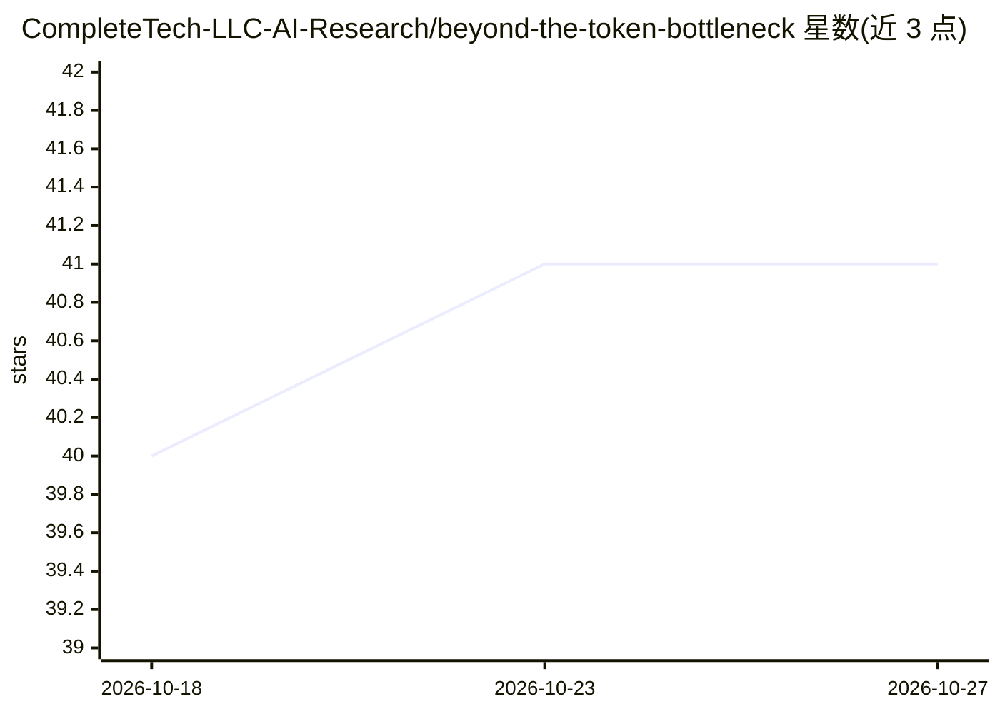

# CompleteTech-LLC-AI-Research/beyond-the-token-bottleneck

⭐ 41 · Python · NOASSERTION · 推送 2026-10-06 · [GitHub](https://github.com/CompleteTech-LLC-AI-Research/beyond-the-token-bottleneck) · 组织维护

**追踪 27 篇潜空间推理与智能体通信文献的 Obsidian 研究维基**

面向 LLM 研究者的开放研究维基，系统整理潜空间推理（连续隐态思考）与智能体间潜通信（替代文本 token 通信）领域 26 篇论文与 1 个开源项目（2022-2026），以 Obsidian vault 形式组织，含 1400+ 内部交叉链接、10 级通信深度光谱分类框架、概念/实体/来源分层页面与维护工作流。采用 Karpathy 描述的 LLM Wiki 模式由 LLM 增量构建维护；使用方式为 git clone 后以 Obsidian 打开。

## 筛选速览

| 维度 | 判定 | 备注 |
|---|---|---|
| AI 角色 | `ai-knowledge` | 知识聚合/清单类 |
| 许可风险 | `none` | NOASSERTION |
| 部署形态 | `None` |  |
| 模型依赖 | — | README 未给出锁定关系 |
| 硬件要求 | — | 无带数字的原话,不猜 |
| 安装摩擦 | `low` | 无编译、无系统依赖或容器化 |
| 成熟度 | `idea` | |

## 能力要点

- 追踪 27 个来源（26 篇论文 + 1 开源项目）并整理为交叉引用知识图谱
- 10 级通信深度光谱框架：从自然语言到完整隐态序列
- 1400+ 内部链接、21 个 Mermaid 图、LaTeX 数学渲染
- 按 LLM Wiki 模式维护，提供 workflows 维护手册与 AGENTS.md 模式定义

## 适用场景

- 系统了解潜空间推理与潜通信领域的研究进展
- 按引导路径阅读从 Pause Tokens 到 Coconut 等方法脉络
- 比较各通信与推理方法的训练、架构与实验结果

## 场景标签

`知识图谱` `科研工具` `精选清单` · 领域:知识与检索

## 证据(README 行号)

> L9: An open research wiki mapping the frontier of **latent-space reasoning**, **continuous thought**, and **inter-agent 
> L25: This wiki systematically tracks **27 sources** (26 papers + 1 open-source project, Dec 2022 – Apr 2026) exploring t

## 星数曲线

2026-10-18 40 → 2026-10-27 41（+1）

---
*卡片 v1 · prompt 1.4 · 生成 2026-10-25 · 置信度 high · 依据 README sha `a25f441f8d6a` · [字段定义](../../DATASET.md)*
