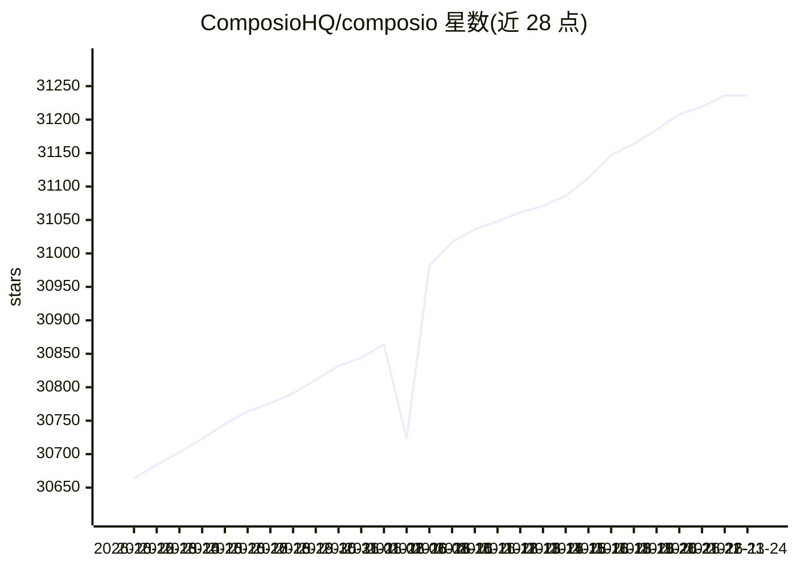

# ComposioHQ/composio

⭐ 31,271 · TypeScript · MIT · 推送 2026-11-24 · [GitHub](https://github.com/ComposioHQ/composio) · [官网](https://docs.composio.dev) · 组织维护

**为 AI agent 提供 1000+ 工具接入的 SDK 平台**

Composio 是一个 SDK monorepo（TypeScript 与 Python 双 SDK 加 CLI），为 AI agent 提供 1000+ 预认证工具集、按用户的会话管理、认证、触发器与沙箱执行环境。会话默认提供可在运行时发现、认证并执行工具的 meta tools，避免将数百条工具定义载入上下文；每个会话可暴露托管 MCP 端点供 MCP 客户端连接。通过 provider 适配层对接 OpenAI Agents、Claude Agent SDK、LangChain 等 agent 框架。需要 COMPOSIO_API_KEY；TypeScript SDK 需 Node 22+，Python SDK 需 Python 3.11+。

## 筛选速览

| 维度 | 判定 | 备注 |
|---|---|---|
| AI 角色 | `ai-ecosystem` | LLM/agent 周边工具 |
| 许可风险 | `permissive` | MIT |
| 部署形态 | `library` | 以包/库形式分发 |
| 模型依赖 | locked-api |  |
| 硬件要求 | — | 无带数字的原话,不猜 |
| 安装摩擦 | `low` | 无编译、无系统依赖或容器化 |
| 成熟度 | — | 结构信号不足 |

## 动量与使用信号

- 维护:`active` — 距上次 push 0.7 天,年发版 100,113 位贡献者
- 涨星:近 1 天 **+29**(自 20261016 起算)
- 安装:npm 包 `@composio/core` 月下载 4,557,062
- 平台:— · 协议:MCP

## 能力要点

- 1000+ 预认证工具集与按用户会话、认证、触发器、沙箱
- 会话 meta tools 在运行时发现并执行工具，控制上下文占用
- 覆盖 17+ 框架的 provider 适配器（OpenAI、Anthropic、LangChain、CrewAI 等）
- CLI 提供 search/execute/link/run 子命令，并可作为编码 agent 的本地工具面

## 适用场景

- 让 agent 跨 1000+ 应用执行操作而无需自行集成各 API
- 通过 MCP 端点将工具接入 Claude、Cursor 等客户端
- 用 CLI 在 shell 中搜索、执行工具并脚本化工作流
- 为自研 agent 框架构建自定义 provider 适配工具

## 场景标签

`Agent 框架` · 领域:Agent 开发

## 证据(README 行号)

> L20: Composio gives your AI agents 1000+ pre-authenticated toolkits, per-user sessions, authentication, triggers, and a 
> L27: - **Provider adapters** for OpenAI Agents, Claude Agent SDK, Vercel AI SDK, LangChain, and more
> L79: A provider adapts Composio tools to your agent framework's native tool format:

## 星数曲线

2026-10-22 30,664 → 2026-11-24 31,236（+572）

---
*卡片 v1 · prompt 1.4 · 生成 2026-11-22 · 置信度 high · 依据 README sha `ac5d76c7832d` · [字段定义](../../DATASET.md)*
