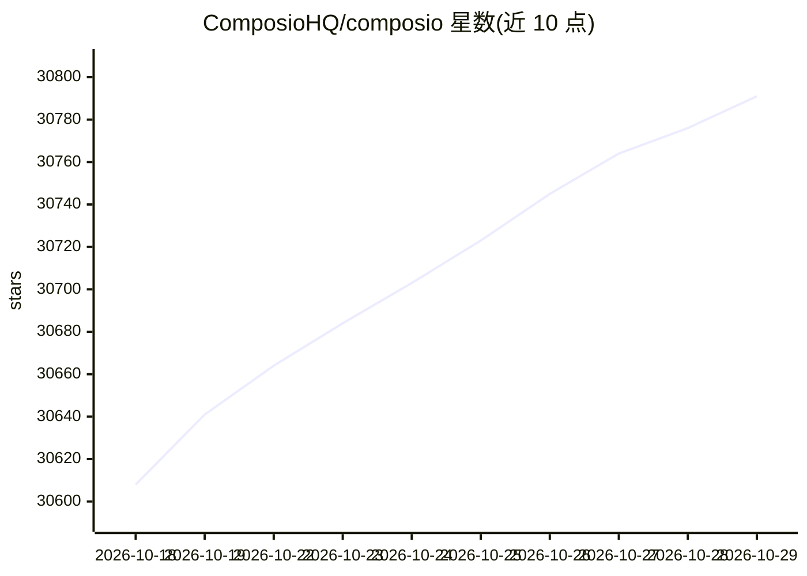

# ComposioHQ/composio

⭐ 30,791 · TypeScript · MIT · 推送 2026-10-28 · [GitHub](https://github.com/ComposioHQ/composio) · [官网](https://docs.composio.dev) · 组织维护

**给 AI Agent 开发者提供 1000+ 工具集成、认证与沙箱的 SDK**

Composio 是一个 SDK monorepo，包含 TypeScript SDK（@composio/core）、Python SDK、CLI 以及多个 provider 适配器。它为 AI Agent 提供 1000+ 预认证工具集、按用户会话、认证、触发器和沙箱；会话默认获得可在运行时发现、认证并执行工具的 meta tools，避免将大量工具定义载入上下文；每个会话也可暴露托管 MCP 端点供 Claude、Cursor 等 MCP 客户端使用。CLI 支持工具搜索、执行、账号连接和 TypeScript 脚本工作流。需要 COMPOSIO_API_KEY。TypeScript SDK 要求 Node 22+，Python SDK 支持 3.10+。

## 筛选速览

| 维度 | 判定 | 备注 |
|---|---|---|
| AI 角色 | `ai-ecosystem` | LLM/agent 周边工具 |
| 许可风险 | `permissive` | MIT |
| 部署形态 | `library` | 以包/库形式分发 |
| 模型依赖 | locked-api |  |
| 硬件要求 | — | 无带数字的原话,不猜 |
| 安装摩擦 | `low` | 无编译、无系统依赖或容器化 |
| 成熟度 | — | 结构信号不足 |

## 动量与使用信号

- 维护:`active` — 距上次 push 0.7 天,年发版 100,113 位贡献者
- 涨星:近 1 天 **+29**(自 20261016 起算)
- 安装:npm 包 `@composio/core` 月下载 4,557,062
- 平台:— · 协议:MCP

## 能力要点

- 1000+ 预认证工具集与按用户会话管理
- meta tools 运行时发现/认证/执行，控制上下文占用
- 每个会话可开启托管 MCP 端点
- 覆盖 OpenAI、Anthropic、LangChain、CrewAI 等的 provider 适配器

## 适用场景

- 让 Agent 跨多个应用执行操作而无需自行维护集成
- 为不同 Agent 框架统一接入工具并管理用户认证
- 通过 CLI 在本地为编码 Agent 提供工具面

## 场景标签

`Agent 框架` · 领域:Agent 开发

## 证据(README 行号)

> L20: Composio gives your AI agents 1000+ pre-authenticated toolkits, per-user sessions, authentication, triggers, and a 
> L27: - **Provider adapters** for OpenAI Agents, Claude Agent SDK, Vercel AI SDK, LangChain, and more

## 星数曲线

2026-10-18 30,608 → 2026-10-29 30,791（+183）

---
*卡片 v1 · prompt 1.4 · 生成 2026-10-18 · 置信度 high · 依据 README sha `7f98b8a67f39` · [字段定义](../../DATASET.md)*
