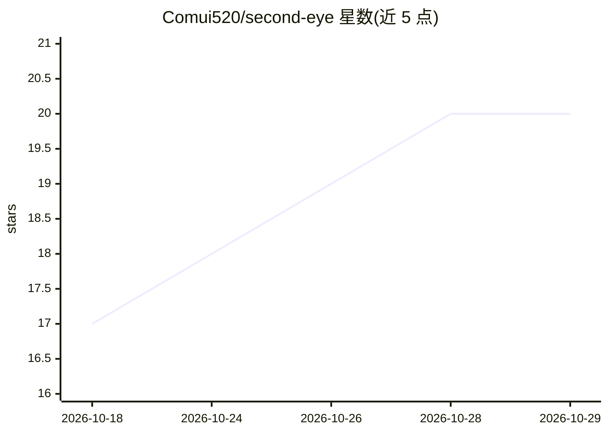

# Comui520/second-eye

⭐ 20 · Python · MIT · 推送 2026-10-27 · [GitHub](https://github.com/Comui520/second-eye) · 个人维护 · 中文 README

**闲鱼二手商品盯价工具：关键词监控+AI品相分析+多渠道推送**

面向中文二手市场（闲鱼）的本地自托管监控工具，基于 Python+FastAPI+SQLite+Playwright。按关键词、价格区间和品相要求监控商品，调用 OpenAI 兼容 LLM 做需求匹配、图片品相分析和批量性价比判断，结果经 Server酱、企业微信、飞书、Gotify 等渠道推送。支持 Docker Compose（含 noVNC 登录模式）、uv 和 Conda 三种部署；数据默认存本地 SQLite。Cookie 登录依赖闲鱼平台，视频分析需本地安装 FFmpeg。

## 筛选速览

| 维度 | 判定 | 备注 |
|---|---|---|
| AI 角色 | `ai-enhanced` | 去掉 AI 部分产品仍成立 |
| 许可风险 | `permissive` | MIT |
| 部署形态 | `self-host` | docker 或自建部署 |
| 模型依赖 | — | README 未给出锁定关系 |
| 硬件要求 | — | 无带数字的原话,不猜 |
| 安装摩擦 | `low` | 无编译、无系统依赖或容器化 |
| 成熟度 | `idea` | |

## 能力要点

- 关键词/价格区间/排除词/品相要求的商品监控与降价重评估
- LLM 需求匹配、图片品相分析与批量性价比判断
- Server酱、企业微信、飞书、Gotify 等多种通知渠道
- 单进程分阶段执行：抓取、媒体、模型步骤持久化并支持恢复

## 适用场景

- 盯特定型号二手商品（如 iPhone 15 / 256GB）的价格与品相
- 通过微信/企业微信等渠道接收符合预算的新品与降价提醒
- 在 NAS 或本地长期运行自托管的二手捡漏监控

## 场景标签

`网页抓取` · 领域:效率与自动化

## 证据(README 行号)

> L10: 一个面向中文二手市场的本地开源工具：按关键词和价格区间监控闲鱼商品，使用 LLM 进行需求匹配、品相分析和批量性价比判断，并通过多种通知渠道推送结果。
> L19: - 需求匹配、图片品相分析、批量性价比判断

## 星数曲线

2026-10-18 17 → 2026-10-29 20（+3）

---
*卡片 v1 · prompt 1.4 · 生成 2026-10-28 · 置信度 high · 依据 README sha `690e52f413ad` · [字段定义](../../DATASET.md)*
