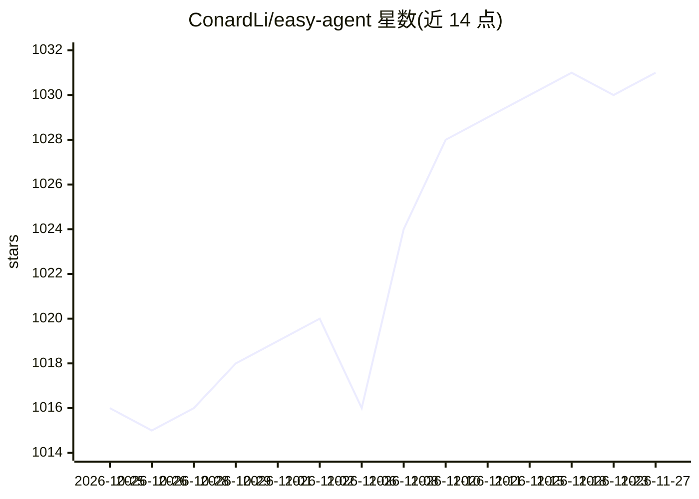

# ConardLi/easy-agent

⭐ 1,031 · TypeScript · MIT · 推送 2026-11-22 · [GitHub](https://github.com/ConardLi/easy-agent) · 个人维护 · 中文 README

**终端编程 Agent：在权限规则下读写代码并执行命令**

在终端中运行的编程 Agent（命令 eagent）：描述任务后由其规划、读取与修改文件、运行测试或 shell 命令并汇报。所有可能更改机器的动作经过 allow/ask/deny 权限规则、工作区信任和可选的 OS 级沙箱（macOS Seatbelt、Linux bubblewrap）。支持 Anthropic、OpenAI 兼容、Gemini 与本地模型，通过环境变量或命名 profile 配置。代码按分层组织并提供文档与学习路径；需 Node.js 22+，Windows 无沙箱。

## 筛选速览

| 维度 | 判定 | 备注 |
|---|---|---|
| AI 角色 | `ai-native` | 本体是模型或模型工具 |
| 许可风险 | `permissive` | MIT |
| 部署形态 | `library` | 以包/库形式分发 |
| 模型依赖 | locked-api |  |
| 硬件要求 | — | 无带数字的原话,不猜 |
| 安装摩擦 | `low` | 无编译、无系统依赖或容器化 |
| 成熟度 | — | 结构信号不足 |

## 能力要点

- 权限规则、工作区信任与 OS 级沙箱的多层安全模型
- 支持 MCP、skills、自定义 agent、hooks、插件等扩展系统
- 持久化会话、文件检查点与 /rewind 回退、Git worktree 隔离的子 agent
- headless JSON/NDJSON 输出、嵌入 SDK、JSON-RPC 与 ACP 协议（Zed/JetBrains）

## 适用场景

- 在陌生代码库中定位功能实现并解释调用流程
- 让 Agent 做多文件修改并在 CI 中以管道方式运行
- 通过自定义 MCP 服务器和插件接入自己的工具

## 场景标签

`编码 Agent` · 领域:编码与开发

## 证据(README 行号)

> L3: A terminal coding agent that reads your code, edits files, and runs commands under permission rules you control.
> L7: Easy Agent (`eagent`) runs in your terminal next to your repository. Describe a task and it plans the work, reads an

## 星数曲线

2026-10-25 1,016 → 2026-11-27 1,031（+15）

---
*卡片 v1 · prompt 1.4 · 生成 2026-11-24 · 置信度 high · 依据 README sha `6e1a22fbd476` · [字段定义](../../DATASET.md)*
