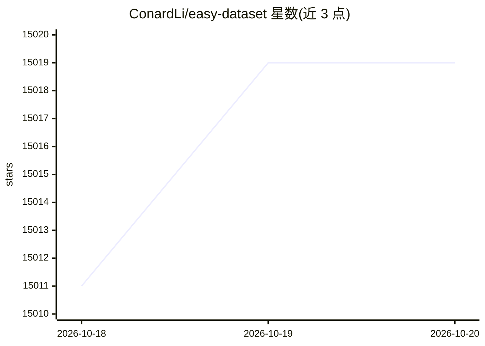

# ConardLi/easy-dataset

⭐ 15,019 · JavaScript · NOASSERTION · 推送 2026-05-01 · [GitHub](https://github.com/ConardLi/easy-dataset) · [官网](https://docs.easy-dataset.com) · 个人维护 · 中文 README

**为开发者从领域文档生成微调/RAG/评测数据集**

面向构建 LLM 数据集的应用：内置文档解析（PDF/Markdown/DOCX/TXT/EPUB）、多种文本切分算法、问题与答案（含 COT）自动生成、数据清洗与领域标签树管理；支持单轮 QA、多轮对话、图像 QA、数据蒸馏等数据集类型，并含自动评测（Judge Model）、人工盲测（Arena）体系。导出 Alpaca/ShareGPT 等格式，一键生成 LLaMA Factory 配置，可上传 Hugging Face Hub。提供 Windows/macOS/Linux 桌面客户端、NPM 与 Docker 运行方式。

## 筛选速览

| 维度 | 判定 | 备注 |
|---|---|---|
| AI 角色 | `ai-native` | 本体是模型或模型工具 |
| 许可风险 | `none` | NOASSERTION |
| 部署形态 | `desktop` | 安装包/桌面程序 |
| 模型依赖 | local-ok | 支持本地模型 |
| 硬件要求 | — | 无带数字的原话,不猜 |
| 安装摩擦 | `low` | 无编译、无系统依赖或容器化 |
| 成熟度 | — | 结构信号不足 |

## 动量与使用信号

- 维护:`maintenance` — 距上次 push 169.7 天,年发版 8,28 位贡献者
- 涨星:近 1 天 **+7**(自 20261016 起算)
- 平台:WINDOWS / MACOS / LINUX · 协议:OLLAMA

## 能力要点

- 文档转多类型数据集：单轮 QA、多轮对话、图像 QA、数据蒸馏
- 自动评测体系：Judge Model 评分与双盲人工 Arena 盲测
- 导出 Alpaca/ShareGPT/Multilingual-Thinking 格式并集成 LLaMA Factory
- 兼容所有 OpenAI 格式 API，支持 Ollama 本地模型

## 适用场景

- 把领域文档加工成微调训练数据集
- 生成测试集自动评估垂直领域模型表现
- 评估 RAG 召回率与微调后模型效果
- 将数据集上传 Hugging Face Hub 分享

## 场景标签

`模型评测` `文档解析` · 领域:评测与运维

## 证据(README 行号)

> L23: Easy Dataset is an application specifically designed for building large language model (LLM) datasets. It features 
> L71: - **Wide Model Compatibility**: Compatible with all LLM APIs that follow the OpenAI format

## 星数曲线

2026-10-18 15,011 → 2026-10-20 15,019（+8）

---
*卡片 v1 · prompt 1.4 · 生成 2026-10-18 · 置信度 high · 依据 README sha `1b1d2c1c4c87` · [字段定义](../../DATASET.md)*
