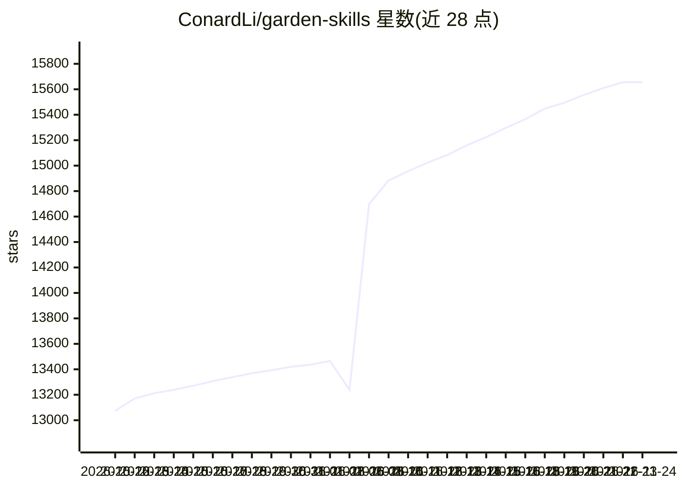

# ConardLi/garden-skills

⭐ 15,704 · JavaScript · MIT · 推送 2026-11-19 · [GitHub](https://github.com/ConardLi/garden-skills) · [官网](https://github.com/ConardLi/garden-skills) · 个人维护 · 中文 README

**为 Claude Code 等 AI 编码 agent 提供的生产级技能合集**

面向 Claude Code、Cursor、Codex 等 AI 编码 agent 的开源技能（Skills）集合，收录 6 个技能：代码渲染短视频（motion-showreel）、网页视频演示（23 个内置主题、可插拔 TTS）、前端设计（25 个风格配方）、GPT Image 2 图像生成（79 个提示模板、三种运行模式）、文章排版（多来源转成品文章）与本地知识检索（kb-retriever）。各技能以 SKILL.md 与 zip 包分发，MIT 许可，提供英文/中文/日文文档。

## 筛选速览

| 维度 | 判定 | 备注 |
|---|---|---|
| AI 角色 | `ai-knowledge` | 知识聚合/清单类 |
| 许可风险 | `permissive` | MIT |
| 部署形态 | `desktop` | 安装包/桌面程序 |
| 模型依赖 | — | README 未给出锁定关系 |
| 硬件要求 | — | 无带数字的原话,不猜 |
| 安装摩擦 | `low` | 无编译、无系统依赖或容器化 |
| 成熟度 | — | 结构信号不足 |

## 能力要点

- 6 个技能覆盖视频、前端设计、图像生成、文章排版、知识检索
- gpt-image-2 技能含 18 个视觉类别与 79 个结构化提示模板，支持三种运行模式
- web-video-presentation 内置 23 个主题与可插拔 TTS（MiniMax/OpenAI 等内置）
- web-design-engineer 提供 6 个设计流派顾问与 25 个锚定风格配方

## 适用场景

- 让编码 agent 生成可录屏的产品演示视频
- 用 agent 产出有设计系统的落地页与仪表盘
- 把 URL/PDF/笔记交给 agent 排版成可分享文章
- 通过本地知识检索技能在 agent 中查文档

## 场景标签

`图像生成` `RAG` `AI 写作` · 领域:内容生成

## 证据(README 行号)

> L3: **A curated collection of production-ready Agent Skills for Claude Code, Cursor, Codex, and other AI coding agents.*
> L32: Skills count

## 星数曲线

2026-10-22 13,073 → 2026-11-24 15,656（+2,583）

---
*卡片 v1 · prompt 1.4 · 生成 2026-11-22 · 置信度 mid · 依据 README sha `87baba4a927b` · [字段定义](../../DATASET.md)*
