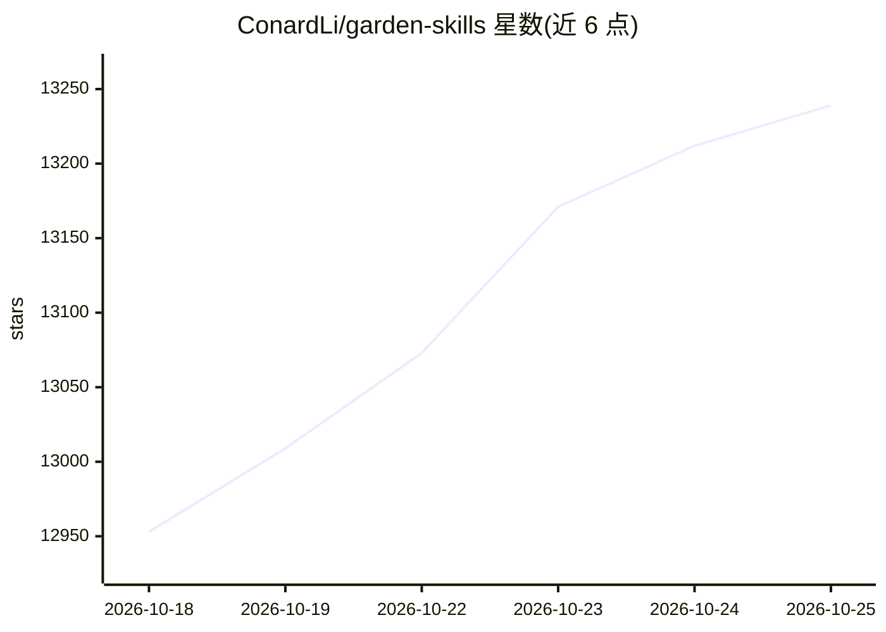

# ConardLi/garden-skills

⭐ 13,239 · JavaScript · MIT · 推送 2026-10-24 · [GitHub](https://github.com/ConardLi/garden-skills) · [官网](https://github.com/ConardLi/garden-skills) · 个人维护 · 中文 README

**面向 AI 编程 agent 的生产级技能集合（6 个 SKILL）**

由 ConardLi 维护的 Agent Skills 策展仓库，提供 6 个面向 Claude Code、Cursor、Codex 等 AI 编程 agent 的 SKILL.md 技能：web-video-presentation（文章转 16:9 网页演示、23 个内置主题、可插拔 TTS）、web-design-engineer（设计系统声明与 25 个风格配方）、gpt-image-2（18 类 79 个图像生成提示模板，支持本地/委派/纯提示三种运行模式）、kb-retriever（本地知识库分层检索，含 PDF/Excel 处理规则）、beautiful-article（多源转排版文章，10 种文章类型）、motion-showreel（动效短视频）。各技能以 .zip 形式分发下载，MIT 许可，附中英日三语文档。

## 筛选速览

| 维度 | 判定 | 备注 |
|---|---|---|
| AI 角色 | `ai-knowledge` | 知识聚合/清单类 |
| 许可风险 | `permissive` | MIT |
| 部署形态 | `desktop` | 安装包/桌面程序 |
| 模型依赖 | — | README 未给出锁定关系 |
| 硬件要求 | — | 无带数字的原话,不猜 |
| 安装摩擦 | `low` | 无编译、无系统依赖或容器化 |
| 成熟度 | — | 结构信号不足 |

## 能力要点

- 6 个覆盖演示、设计、图像生成、检索、编辑排版、动效视频的 SKILL 技能
- 兼容 Claude Code / Cursor / Codex 等 AI 编程 agent
- 每个技能附带 README、SKILL.md 与 .zip 版本化下载

## 适用场景

- 为我的 AI 编程 agent 安装网页设计或排版技能
- 把文章或脚本转成可录屏的网页演示
- 让 agent 从本地知识目录带出处地回答问题

## 场景标签

`图像生成` `AI 写作` `文档问答` · 领域:内容生成

## 证据(README 行号)

> L3: **A curated collection of production-ready Agent Skills for Claude Code, Cursor, Codex, and other AI coding agents.*
> L67: Links: README · SKILL.md · Download v1.2.2 .zip

## 星数曲线

2026-10-18 12,953 → 2026-10-25 13,239（+286）

---
*卡片 v1 · prompt 1.4 · 生成 2026-10-20 · 置信度 mid · 依据 README sha `27d6246b2ff2` · [字段定义](../../DATASET.md)*
