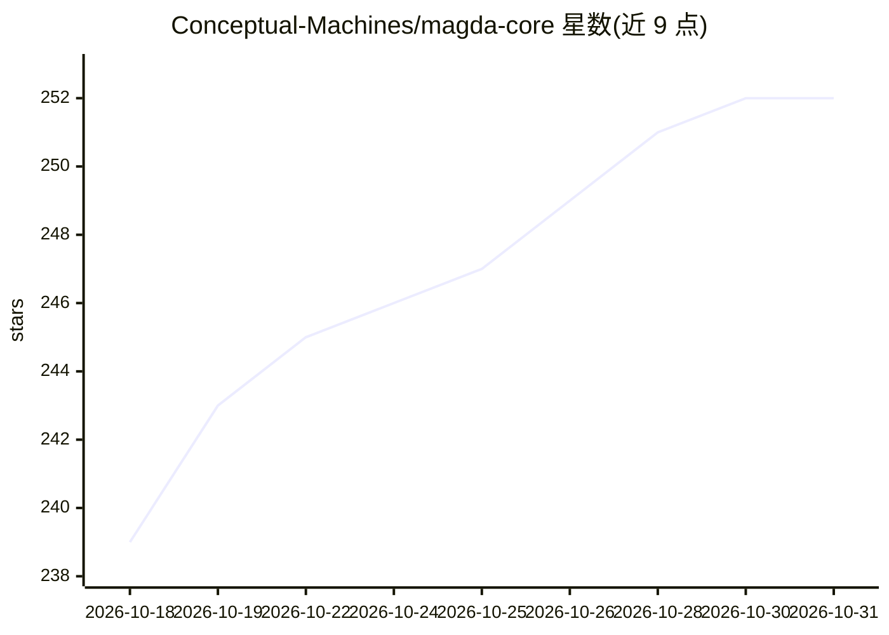

# Conceptual-Machines/magda-core

⭐ 252 · C++ · GPL-3.0 · 推送 2026-10-30 · [GitHub](https://github.com/Conceptual-Machines/magda-core) · [官网](https://magda.land/) · 组织维护 · 中文 README

**内置 AI 聊天助手的开源 DAW（数字音频工作站）**

基于 C++23、JUCE 与 Tracktion Engine 的免费开源 DAW，采用混合音轨（音频+MIDI 同轨）、Arrangement/Session/Mix 三视图、每设备 16 LFO+16 宏控的调制系统、可嵌套 rack 与钢琴卷帘等常规 DAW 功能。AI 部分为应用内聊天：自然语言命令生成并执行自定义 DSL，用户自带 API Key（BYOAK），依赖 juce-llm 客户端模块与内嵌 llama.cpp 本地推理。处于 v0 早期，需自行编译。

## 筛选速览

| 维度 | 判定 | 备注 |
|---|---|---|
| AI 角色 | `ai-enhanced` | 去掉 AI 部分产品仍成立 |
| 许可风险 | `viral` | GPL-3.0 |
| 部署形态 | `None` |  |
| 模型依赖 | — | README 未给出锁定关系 |
| 硬件要求 | — | 无带数字的原话,不猜 |
| 安装摩擦 | `medium` | 含编译或系统依赖之一 |
| 成熟度 | `idea` | |

## 能力要点

- 自然语言命令生成并执行自定义 DSL（BYOAK 自带 API Key）
- 混合音轨：每轨同时承载音频与 MIDI clip
- 每设备/rack 16 LFO 与 16 宏控的调制系统
- 内嵌 llama.cpp 本地 LLM 推理

## 适用场景

- 音乐制作与编曲，使用混合音轨与三视图工作流
- 通过聊天用自然语言操作 DAW 功能
- 本地运行 LLM 进行离线 AI 命令处理

## 场景标签

`AI 助手` · 领域:对话与助手

## 证据(README 行号)

> L14: MAGDA is a free, open-source DAW with AI integrated from the ground up. Built on C++23, JUCE, and Tracktion Engine.
> L21: - **AI chat**: natural language commands that generate and execute a custom DSL directly in the app (BYOAK, Bring Y

## 星数曲线

2026-10-18 239 → 2026-10-31 252（+13）

---
*卡片 v1 · prompt 1.4 · 生成 2026-10-22 · 置信度 high · 依据 README sha `b9c3b8aefa30` · [字段定义](../../DATASET.md)*
